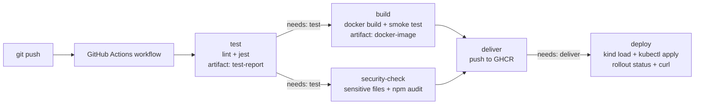

# Session 16 — CI/CD with GitHub Actions

| | |
|---|---|
| **Student** | Ujjawal Prabhat |
| **Enrollment No.** | 24BCS10267 |
| **Session** | 16 — CI/CD & GitHub Actions |
| **Branch** | `24BCS10267/session-16` |
| **Workflow file** | [`.github/workflows/24bcs10267-session16-cicd.yml`](../../.github/workflows/24bcs10267-session16-cicd.yml) |

## Task checklist

- [x] CI vs CD: explained, and both run in one pipeline
- [x] Pipeline: lint → test → security check → build → push → deploy, chained with `needs`
- [x] Workflow: triggered by `push` (this branch), `pull_request` (into `main`) and `workflow_dispatch`, filtered by path
- [x] Jobs and steps: 5 jobs (`test`, `security-check`, `build`, `deliver`, `deploy`), each made of named steps
- [x] Runners: GitHub-hosted `ubuntu-latest`, Node 22
- [x] Secrets: repo secret `APP_GREETING` → Kubernetes Secret → container env var (never printed). `GITHUB_TOKEN` is used to push to GHCR
- [x] Artifacts: JUnit test report and the Docker image tarball
- [x] Build: `docker build` plus a container smoke test
- [x] Test: Jest unit and HTTP tests, including the hands-on `power()` operation
- [x] CD: image pushed to `ghcr.io/ujjawalprabhat/s16-cicd-demo-24bcs10267`, and the same image tarball loaded into a kind cluster in the runner and deployed with `kubectl apply`, `rollout status` and a curl smoke test
- [x] Execution: one real green run on this branch, all 5 jobs passing (section 3)

---

## 1. Project layout

```text
session-16-github-actions/24BCS10267-ujjawal-prabhat/
├── src/
│   ├── app.js          # Express app factory (/, /health, /api/:op)
│   ├── calculator.js   # add / subtract / multiply / divide / power
│   └── server.js       # entrypoint (PORT, default 3000)
├── test/app.test.js    # 13 Jest + supertest tests
├── k8s/
│   ├── deployment.yaml # 2 replicas, probes, env from Secret
│   └── service.yaml    # ClusterIP :80 -> 3000
├── Dockerfile          # node:22-alpine, npm ci --omit=dev, USER node
├── eslint.config.js
├── package.json / package-lock.json
└── README.md
.github/workflows/24bcs10267-session16-cicd.yml   # at repo root, where GitHub reads workflows
```

### Run locally

```bash
cd session-16-github-actions/24BCS10267-ujjawal-prabhat
npm ci
npm run lint
npm test                      # jest --ci -> reports/junit.xml
npm start                     # http://localhost:3000

docker build -t s16-cicd-demo .
docker run -p 3000:3000 -e APP_GREETING="hi" s16-cicd-demo
curl "localhost:3000/api/power?a=2&b=10"
```

`k8s/deployment.yaml` contains the placeholders `__IMAGE__` and `__VERSION__`. The `deploy` job fills them with `sed` (image tag and short commit SHA) before `kubectl apply`, so replace them yourself before applying the manifest by hand.

---

## 2. Concepts

### What is GitHub Actions

GitHub Actions is GitHub's built-in automation platform. A YAML workflow in `.github/workflows/` says which events (push, pull request, manual run) start it, and GitHub runs its jobs on runner machines and shows the logs and artifacts in the Actions tab.

### CI vs CD

| | Continuous Integration (CI) | Continuous Delivery / Deployment (CD) |
|---|---|---|
| Goal | Every change is checked automatically | Every change that passes CI can be released |
| In this pipeline | `test` job: install, lint, unit tests; `security-check` job: sensitive-file check + `npm audit`; `build` job: Docker image + container smoke test | `deliver` job: push image to GHCR (**delivery**); `deploy` job: roll it out to Kubernetes and smoke-test it (**deployment**) |
| Runs on | push, pull_request, manual | only `push` / `workflow_dispatch` on `UjjawalPrabhat/devops-heros` (`if:`). Pull requests stop after `build` |

### Pipeline



If `test` fails, every later job is **skipped**. If `security-check` fails, nothing is pushed or deployed. This comes from the `needs:` lines in the workflow: `security-check` and `build` have `needs: test` ([L76](../../.github/workflows/24bcs10267-session16-cicd.yml#L76), [L95](../../.github/workflows/24bcs10267-session16-cicd.yml#L95)), `deliver` has `needs: [build, security-check]` ([L133](../../.github/workflows/24bcs10267-session16-cicd.yml#L133)) and `deploy` has `needs: deliver` ([L172](../../.github/workflows/24bcs10267-session16-cicd.yml#L172)).

### Workflow, jobs, steps, runners

- **Workflow**: the YAML file at `.github/workflows/24bcs10267-session16-cicd.yml`. GitHub only reads workflows from the repo root, so the file lives there. `defaults.run.working-directory` points every `run:` step at this folder.
- **Triggers**: `push` (only branch `24BCS10267/session-16`), `pull_request` (into `main`) and `workflow_dispatch`. Push and pull request use a `paths` filter on this folder and the workflow file. `!**/*.md` stops README-only commits from starting the pipeline.
- **Jobs**: `test`, `security-check`, `build`, `deliver`, `deploy`. Each job gets a fresh VM. Jobs share data only through **artifacts**: `build` uploads the image tarball, and both `deliver` and `deploy` download it.
- **Steps**: either `uses:` (a reusable action such as `actions/checkout@v7`, `actions/setup-node@v7`, `docker/login-action@v4` or `helm/kind-action@v1`) or `run:` (shell commands).
- **Runners**: every job runs on the GitHub-hosted `ubuntu-latest` runner.

### Secrets

| Secret | Kind | Used for |
|---|---|---|
| `APP_GREETING` | repo secret, created with `gh secret set APP_GREETING -R UjjawalPrabhat/devops-heros` | Passed through `env:` to `kubectl create secret generic s16-app-secrets`. The Deployment reads it with `secretKeyRef`. The app reports only `greetingSource: "secret"`, and the smoke test checks that field. The value itself is never echoed (it shows as `***` in logs). |
| `GITHUB_TOKEN` | provided automatically, scoped per job by `permissions:` | `packages: write` in `deliver`, passed to `docker/login-action` to push to GHCR |

The workflow sets `permissions: contents: read` at the top level, so each job gets read-only access unless it asks for more (least privilege).

### Artifacts

| Artifact | Produced by | Contents |
|---|---|---|
| `test-report` | `test` (`if: always()`, so it uploads on failure too) | `reports/junit.xml` |
| `docker-image` | `build` | `s16-cicd-demo.tar.gz` (`docker save`). `deliver` pushes it to GHCR and `deploy` loads it into kind with `kind load image-archive`, so the image that was tested is the image that gets shipped. |

---

## 3. Execution evidence (run 38903497733)

Run: [38903497733](https://github.com/UjjawalPrabhat/devops-heros/actions/runs/38903497733), triggered by `push` of commit `93d4bfd` on `24BCS10267/session-16`. All output below comes from that run. Commit `93d4bfd` had the same code, workflow and files as this branch; only this README was updated afterwards. The commands were run from this folder, and every filter is part of the command shown.

```bash
export RUN=38903497733 R=UjjawalPrabhat/devops-heros
```

### 3.1 Run result and jobs

```bash
gh run view $RUN -R $R --json conclusion,headSha,headBranch,event,createdAt,jobs \
  --jq '"\(.conclusion) \(.headSha) \(.headBranch) \(.event) \(.createdAt)", (.jobs[] | "\(.name): \(.conclusion)")'
```

```text
success 93d4bfd0bcab729b2586f1b4b0f85ff4e9ac5186 24BCS10267/session-16 push 2026-10-16T12:51:32Z
Test (lint + unit tests): success
Security Check: success
Build Docker image: success
Push image to GHCR: success
Deploy to Kubernetes (kind): success
```

### 3.2 `test` job: runner, lint, unit tests, test-report artifact

`gh run view --log` prints `job<TAB>step<TAB>timestamp line`. The `awk` keeps one job's lines and `cut -d' ' -f2-` drops the timestamp.

```bash
gh run view $RUN -R $R --log | awk -F'\t' '$1=="Test (lint + unit tests)" {print $3}' | cut -d' ' -f2- \
  | grep -E '^Runner OS|^v[0-9]+\.|^> |^PASS|✓|^Tests:|^Artifact test-report has been'
```

```text
Runner OS: Linux / arch: X64
v22.23.3
> s16-cicd-demo@1.0.0 lint
> eslint .
> s16-cicd-demo@1.0.0 test
> jest --ci
PASS test/app.test.js
    ✓ add (2 ms)
    ✓ subtract (1 ms)
    ✓ multiply
    ✓ divide
    ✓ power (1 ms)
    ✓ divide by zero throws (3 ms)
    ✓ GET /health returns ok (30 ms)
    ✓ GET / uses default greeting when no secret is set (11 ms)
    ✓ GET / uses APP_GREETING when the secret is set (3 ms)
    ✓ GET /api/add computes a sum (4 ms)
    ✓ GET /api/divide by zero returns 400 (4 ms)
    ✓ non-numeric input returns 400 (3 ms)
    ✓ unknown operation returns 404 (2 ms)
Tests:       13 passed, 13 total
Artifact test-report has been successfully uploaded! Final size is 583 bytes. Artifact ID is 12046498264
```

### 3.3 `security-check` job

```bash
gh run view $RUN -R $R --log | awk -F'\t' '$1=="Security Check" {print $3}' | cut -d' ' -f2- \
  | grep -E '^No common sensitive|^# npm audit report|severity vulnerabilit'
```

```text
No common sensitive files found.
# npm audit report
21 moderate severity vulnerabilities
```

`npm audit --audit-level=high` only fails on high or critical findings. The 21 findings are moderate (they come from the `jest` / `jest-junit` dev-dependency tree), so the step passed. The production image installs with `npm ci --omit=dev`, and `npm ci` in the Docker build reported `found 0 vulnerabilities`.

### 3.4 `build` job: image, container smoke test, docker-image artifact

```bash
gh run view $RUN -R $R --log | awk -F'\t' '$1=="Build Docker image" {print $3}' | cut -d' ' -f2- \
  | grep -E 'naming to|^REPOSITORY|^s16-cicd-demo |^\{"|^-rw|^Artifact docker-image has been'
```

```text
#11 naming to docker.io/library/s16-cicd-demo:93d4bfd0bcab729b2586f1b4b0f85ff4e9ac5186 done
REPOSITORY      TAG                                        IMAGE ID       CREATED        SIZE
s16-cicd-demo   93d4bfd0bcab729b2586f1b4b0f85ff4e9ac5186   186cc3061dda   1 second ago   171MB
{"status":"ok"}
{"op":"power","a":2,"b":10,"result":1024}
-rw-r--r-- 1 runner runner 58M Oct 16 12:52 s16-cicd-demo.tar.gz
Artifact docker-image has been successfully uploaded! Final size is 60096494 bytes. Artifact ID is 12046449463
```

### 3.5 `deliver` job: push to GHCR with `GITHUB_TOKEN`

```bash
gh run view $RUN -R $R --log | awk -F'\t' '$1=="Push image to GHCR" {print $3}' | cut -d' ' -f2- \
  | grep -E '^Loaded image|^  (registry|username|password):|^Login Succeeded|push refers|digest: sha256'
```

```text
Loaded image: s16-cicd-demo:93d4bfd0bcab729b2586f1b4b0f85ff4e9ac5186
  registry: ghcr.io
  username: UjjawalPrabhat
  password: ***
Login Succeeded!
The push refers to repository [ghcr.io/ujjawalprabhat/s16-cicd-demo-24bcs10267]
93d4bfd: digest: sha256:5a1795abf30f66ee1096cce6110e01d05d3d9a1b299598a5ae5a140aad7d87ac size: 1992
The push refers to repository [ghcr.io/ujjawalprabhat/s16-cicd-demo-24bcs10267]
latest: digest: sha256:5a1795abf30f66ee1096cce6110e01d05d3d9a1b299598a5ae5a140aad7d87ac size: 1992
```

The package is public, so it can be checked without logging in (`DOCKER_CONFIG` points at an empty directory, so no stored credentials are used):

```bash
export DOCKER_CONFIG=$(mktemp -d)
for t in 93d4bfd latest; do
  docker manifest inspect -v ghcr.io/ujjawalprabhat/s16-cicd-demo-24bcs10267:$t \
    | jq -r '"\(.Ref)  manifest=\(.Descriptor.digest)  config=\(.SchemaV2Manifest.config.digest)  layers=\(.SchemaV2Manifest.layers|length)"'
done
```

```text
ghcr.io/ujjawalprabhat/s16-cicd-demo-24bcs10267:93d4bfd  manifest=sha256:5a1795abf30f66ee1096cce6110e01d05d3d9a1b299598a5ae5a140aad7d87ac  config=sha256:186cc3061ddac305d2461f7ca0da408ec55da2c0fb4508eb612595086ddc688c  layers=8
ghcr.io/ujjawalprabhat/s16-cicd-demo-24bcs10267:latest  manifest=sha256:5a1795abf30f66ee1096cce6110e01d05d3d9a1b299598a5ae5a140aad7d87ac  config=sha256:186cc3061ddac305d2461f7ca0da408ec55da2c0fb4508eb612595086ddc688c  layers=8
```

The manifest digest matches the one printed by `docker push`, and the config digest starts with `186cc3061dda`, the IMAGE ID from the `build` job. So GHCR holds the exact image that was built and smoke-tested.

### 3.6 `deploy` job: kind cluster in the runner

The `sed -n` range starts at the secret step and stops at job cleanup. The `grep -v` removes the step headers and the echoed script lines.

```bash
gh run view $RUN -R $R --log | awk -F'\t' '$1=="Deploy to Kubernetes (kind)" {print $3}' | cut -d' ' -f2- \
  | sed -n '/^secret\/s16-app-secrets/,/^Post job cleanup/p' | grep -vE '^(Post job|##|shell:|env:|  [A-Z_]+:|$)|\^\['
```

```text
secret/s16-app-secrets created
NAME              TYPE     DATA   AGE
s16-app-secrets   Opaque   1      0s
19:          image: s16-cicd-demo:93d4bfd0bcab729b2586f1b4b0f85ff4e9ac5186
deployment.apps/s16-cicd-demo created
service/s16-cicd-demo created
Waiting for deployment "s16-cicd-demo" rollout to finish: 0 of 2 updated replicas are available...
Waiting for deployment "s16-cicd-demo" rollout to finish: 1 of 2 updated replicas are available...
deployment "s16-cicd-demo" successfully rolled out
NAME                            READY   UP-TO-DATE   AVAILABLE   AGE   CONTAINERS   IMAGES                                                   SELECTOR
deployment.apps/s16-cicd-demo   2/2     2            2           2s    app          s16-cicd-demo:93d4bfd0bcab729b2586f1b4b0f85ff4e9ac5186   app=s16-cicd-demo
NAME                                       DESIRED   CURRENT   READY   AGE   CONTAINERS   IMAGES                                                   SELECTOR
replicaset.apps/s16-cicd-demo-85c66ff45c   2         2         2       2s    app          s16-cicd-demo:93d4bfd0bcab729b2586f1b4b0f85ff4e9ac5186   app=s16-cicd-demo,pod-template-hash=85c66ff45c
NAME                                 READY   STATUS    RESTARTS   AGE   IP           NODE                           NOMINATED NODE   READINESS GATES
pod/s16-cicd-demo-85c66ff45c-msssc   1/1     Running   0          2s    10.244.0.6   s16-24bcs10267-control-plane   <none>           <none>
pod/s16-cicd-demo-85c66ff45c-p9tns   1/1     Running   0          2s    10.244.0.5   s16-24bcs10267-control-plane   <none>           <none>
NAME                    TYPE        CLUSTER-IP    EXTERNAL-IP   PORT(S)   AGE   SELECTOR
service/kubernetes      ClusterIP   10.96.0.1     <none>        443/TCP   27s   <none>
service/s16-cicd-demo   ClusterIP   10.96.111.4   <none>        80/TCP    2s    app=s16-cicd-demo
{"status":"ok"}
greetingSource=secret version=93d4bfd
{"op":"add","a":40,"b":2,"result":42}
```

The pods run the image loaded from the `docker-image` artifact (`s16-cicd-demo:<full sha>`), which is the same image that was pushed to GHCR. `greetingSource=secret` shows that the `APP_GREETING` repo secret reached the pod through the Kubernetes Secret. Its value is never printed (`APP_GREETING: ***` in the step env).

### 3.7 Artifacts of the run

```bash
gh api repos/$R/actions/runs/$RUN/artifacts \
  --jq '.artifacts[] | "\(.name)  \(.size_in_bytes) bytes  id=\(.id)  expired=\(.expired)"'
```

```text
test-report  583 bytes  id=12046498264  expired=false
docker-image  60096494 bytes  id=12046449463  expired=false
```

### Notes

- The four jobs that use `actions/checkout` end with the annotation `The process '/usr/bin/git' failed with exit code 128`. It comes from the post-checkout cleanup, which hits a broken submodule entry that already exists in the upstream repo (`session-16-github-actions/mini-project 10-33-34-265` has no `.gitmodules` URL). It is a warning only and does not affect the pipeline.
