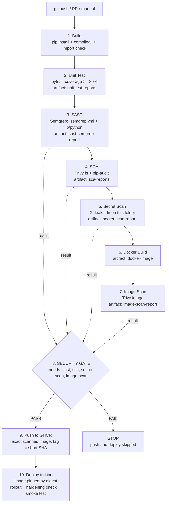

# Session 17 — DevSecOps

| | |
|---|---|
| **Student** | Ujjawal Prabhat |
| **Enrollment No.** | 24BCS10267 |
| **Session** | 17 — DevSecOps (secure CI/CD pipeline) |
| **Branch** | `24BCS10267/session-17` |
| **Workflow file** | [`.github/workflows/24bcs10267-session17-devsecops.yml`](../../.github/workflows/24bcs10267-session17-devsecops.yml) |

## Task checklist

- [x] Pipeline in this exact order: **Build → Unit Test → SAST → SCA → Secret scan → Docker build → Image scan → Security gate → Push → Deploy**
- [x] SAST: **Semgrep**, custom rules in [`.semgrep.yml`](.semgrep.yml) plus the community `p/python` ruleset
- [x] SCA: **Trivy fs** (gating) and **pip-audit** (informational)
- [x] Secret scanning: **Gitleaks** with [`.gitleaks.toml`](.gitleaks.toml), scoped to this folder only
- [x] Container image scanning: **Trivy image** with [`trivy.yaml`](trivy.yaml), policy HIGH/CRITICAL
- [x] Security gate: one job that `needs` all four scans and fails on HIGH/CRITICAL, Semgrep ERROR, or any secret. It also fails closed if a scanner crashes.
- [x] Push to **GHCR** (`ghcr.io/ujjawalprabhat/s17-devsecops-demo-24bcs10267`) with `GITHUB_TOKEN`, only after the gate passes
- [x] Deploy to Kubernetes (kind cluster in the runner). Manifests use `runAsNonRoot`, `readOnlyRootFilesystem`, drop ALL capabilities, resource limits, and readiness/liveness probes. The image is pinned by digest. Hardening is checked at runtime.
- [x] Scan reports (JSON + text) uploaded as artifacts
- [x] Gate shown working: its decision table from the green run (all four checks PASS, §5.8), and the blocking logic in the workflow ([L316-L331](../../.github/workflows/24bcs10267-session17-devsecops.yml#L316-L331))
- [x] Trivy run locally (installed with Homebrew), real output included
- [x] No `.trivyignore`: the image has 0 HIGH/CRITICAL findings, so nothing needs suppressing

---

## 1. Project layout

```text
session-17-devsecops/24BCS10267-ujjawal-prabhat/
├── app/main.py            # Flask API: /, /health, /api/status, /api/greet/<name>, /api/calc
├── tests/test_app.py      # 12 pytest tests (coverage gate 80%, currently 100%)
├── k8s/
│   ├── deployment.yaml    # hardened Deployment (securityContext, limits, probes, tmpfs /tmp)
│   └── service.yaml
├── Dockerfile             # multi-stage, python:3.12-alpine, pip removed, USER 10001
├── requirements.txt       # Flask, gunicorn (runtime)
├── requirements-dev.txt   # + pytest, pytest-cov
├── pytest.ini
├── .semgrep.yml           # SAST custom rules
├── .gitleaks.toml         # secret-scan config (default rules + custom rule)
├── trivy.yaml             # SCA + image scan policy
└── README.md
.github/workflows/24bcs10267-session17-devsecops.yml   # at repo root, where GitHub reads workflows
```

### Run locally

```bash
cd session-17-devsecops/24BCS10267-ujjawal-prabhat
python3 -m venv .venv && . .venv/bin/activate
pip install -r requirements-dev.txt
python -m pytest                                  # tests + coverage
docker build -t s17-devsecops-demo:local .
trivy image --config trivy.yaml s17-devsecops-demo:local
docker run --rm -p 8080:8080 --read-only --tmpfs /tmp --cap-drop ALL s17-devsecops-demo:local
curl -X POST localhost:8080/api/calc -H 'Content-Type: application/json' -d '{"op":"multiply","a":6,"b":7}'
```

---

## 2. Pipeline flow



### Gate design

Every scan job runs its tool in **report mode**. It always writes a JSON report (plus a text/table view), uploads them as an artifact, and publishes two job outputs: `findings` (a count) and `result` (`pass`/`fail`). Findings appear as `::error` annotations on the file and line. Because the scan jobs don't stop the chain, **every scanner runs on every commit**, and the gate sees the whole picture instead of only the first failure.

The `security-gate` job uses `needs: [sast, sca, secret-scan, image-scan]` and `if: always()`. It fails if any check has `job != success` **or** `result != pass`:

| Check | Tool | Blocking policy |
|---|---|---|
| SAST | Semgrep | any finding with severity `ERROR` (WARNINGs are reported only) |
| SCA | Trivy fs | any `HIGH` or `CRITICAL` dependency CVE |
| Secrets | Gitleaks | any secret |
| Image | Trivy image | any `HIGH` or `CRITICAL` CVE (OS packages and Python packages; unfixed CVEs count too) |

It is **fail-closed**. If a scanner itself crashes or is skipped, its job result is not `success` and the gate fails. The decision logic is these workflow lines ([L316-L331](../../.github/workflows/24bcs10267-session17-devsecops.yml#L316-L331)):

```bash
row() { # name tool policy job result findings
  local verdict="PASS"
  if [ "$4" != "success" ] || [ "$5" != "pass" ]; then verdict="FAIL"; FAIL=1; fi
  ...
}
...
if [ "$FAIL" -ne 0 ]; then
  ...
  echo "::error::Security gate FAILED - push and deploy are blocked"
  exit 1
fi
```

Each scan job sets `result=fail` when it finds something blocking ([SAST L120](../../.github/workflows/24bcs10267-session17-devsecops.yml#L120), [SCA L164](../../.github/workflows/24bcs10267-session17-devsecops.yml#L164), [Secrets L204](../../.github/workflows/24bcs10267-session17-devsecops.yml#L204), [Image L272](../../.github/workflows/24bcs10267-session17-devsecops.yml#L272)). `push` has `needs: security-gate` ([L338](../../.github/workflows/24bcs10267-session17-devsecops.yml#L338)), and `deploy` has `needs: push` ([L378](../../.github/workflows/24bcs10267-session17-devsecops.yml#L378)). A failed gate therefore skips both, and nothing reaches the registry or the cluster.

`push` runs only on `push`/`workflow_dispatch` events in `UjjawalPrabhat/devops-heros` (not on pull requests or forks). It loads the **same image tarball that was scanned** from the `docker-image` artifact, so the image that gets pushed is byte-for-byte the image that was scanned. `deploy` pins the image by **digest** (`@sha256:…`), not by tag.

---

## 3. Tools and config files

### SAST: Semgrep (`.semgrep.yml`)
Semgrep reads source code without running it (pattern matching over the code's syntax tree). The pipeline runs `semgrep scan --config .semgrep.yml --config p/python app tests`. That is 155 rules: 4 custom ones plus the community Python ruleset.

| Custom rule | Severity | Catches |
|---|---|---|
| `s17-flask-debug-enabled` | ERROR | `app.run(debug=True)`, `app.debug = True` (Werkzeug debugger allows remote code execution, CWE-489) |
| `s17-subprocess-shell-true` | ERROR | `subprocess.*(shell=True)`, `os.system` (CWE-78) |
| `s17-unsafe-yaml-load` | ERROR | `yaml.load` without `SafeLoader` (CWE-502) |
| `s17-eval-exec` | ERROR | `eval` / `exec` (CWE-95) |

### SCA: Trivy fs + pip-audit
- **Trivy fs** (gating): `trivy fs --config trivy.yaml .` reads `requirements.txt` and matches the pinned packages against the Trivy vulnerability DB (NVD, GitHub advisories, and others), which includes severities.
- **pip-audit** (informational): resolves the **full dependency tree** (including transitive packages) against the PyPI/OSV advisory DB. pip-audit reports no severity, so it would not fit a "HIGH/CRITICAL" policy. It raises a `::warning` and uploads `pip-audit.txt`, and the gate does not use it. Transitive packages are still gated, because the image scan in step 7 sees every package installed in the image.

### Secret scanning: Gitleaks (`.gitleaks.toml`)
- `[extend] useDefault = true` keeps all built-in rules (AWS, GitHub, Slack, private keys, JWT, generic API keys, and so on).
- A custom rule `s17-demo-api-token` (`s17demo_[a-f0-9]{32}`) adds an organisation-specific token format, so the rule set can be tested without a real-looking provider credential (which GitHub push protection would also block).
- **Scoped to this folder**: the job runs `gitleaks dir .` from `session-17-devsecops/24BCS10267-ujjawal-prabhat`. Other students' files in the shared repo are not scanned. `--redact` keeps the secret value out of the logs.
- Note: `dir` mode scans the current tree only, not git history. If a real credential were ever committed, deleting it is not enough: rotate or revoke it first, then clean the history (course §06).

### Container image scanning: Trivy (`trivy.yaml`)
```yaml
severity: [HIGH, CRITICAL]
scan: { scanners: [vuln] }
vulnerability: { ignore-unfixed: false }   # strict: unfixed CVEs count too
db: { repository: [mirror.gcr.io/aquasec/trivy-db] }
```
The same file drives the local scan, `trivy fs` and `trivy image`. It sets no `exit-code`, so Trivy always exits 0 and writes its JSON report; `trivy convert --format table` prints the readable view from that JSON. The security gate counts the HIGH/CRITICAL entries and decides.

Trivy is installed with Aqua's official `aquasecurity/setup-trivy@v0.3.1` action, pinned to Trivy `v0.75.0`. Gitleaks is installed from its **GitHub release tarball, checked against the published SHA-256 checksum**. Semgrep is pinned to `1.179.0` with pip.

### Why the base image is `python:3.12-alpine` (real local Trivy result)

I first tried the Debian slim base. Local scan (`trivy image --severity HIGH,CRITICAL`):

```text
python:3.12-slim (debian 13.7)
==============================
Total: 44 (HIGH: 44, CRITICAL: 0)
```

Those findings are in OS packages such as `util-linux`, `libsystemd0` and `ncurses`, most with status `affected` (no fix available). My first slim-based image also had 4 HIGH findings in `pip`/`setuptools` and their vendored `urllib3`/`msgpack`. Switching to `python:3.12-alpine`, running `apk upgrade` and **removing pip/setuptools from the runtime image** brought it to **0 HIGH/CRITICAL** without any `.trivyignore`.

---

## 4. Kubernetes hardening (`k8s/deployment.yaml`)

| Control | Setting |
|---|---|
| Non-root | pod and container `runAsNonRoot: true`, `runAsUser/runAsGroup: 10001` (the image also sets `USER 10001:10001`) |
| Read-only root FS | `readOnlyRootFilesystem: true`; only `/tmp` is writable (in-memory `emptyDir`, 16Mi) for gunicorn's worker heartbeat files |
| Privilege | `allowPrivilegeEscalation: false`, `privileged: false`, `capabilities.drop: [ALL]`, `seccompProfile: RuntimeDefault` |
| Resources | requests `50m / 64Mi`, limits `250m / 192Mi` |
| Probes | readiness and liveness on `GET /health` |
| API access | `automountServiceAccountToken: false` |
| Supply chain | image pinned by digest; GHCR pull via `imagePullSecret` `ghcr-pull`, created from the job's `GITHUB_TOKEN` (`packages: read`) |

The deploy job **checks these settings on the running pod** (`kubectl get pod -o jsonpath=…securityContext`, `id`, and a `touch /app/...` that must fail). See §5.10.

The app adds `X-Content-Type-Options`, `X-Frame-Options` and `Content-Security-Policy` headers and HTML-escapes user input in `/api/greet/<name>`. gunicorn runs with `--no-control-socket`, because gunicorn 26 would otherwise try to create a socket in `$HOME`, which is read-only.

---

## 5. Execution evidence (run 38903497482)

Run: [38903497482](https://github.com/UjjawalPrabhat/devops-heros/actions/runs/38903497482), triggered by `push` of commit `945e423` on `24BCS10267/session-17`. All output below comes from that run. Commit `945e423` had the same code, workflow and files as this branch; only this README was updated afterwards. The commands were run from this folder, and every filter is part of the command shown.

```bash
export RUN=38903497482 R=UjjawalPrabhat/devops-heros
```

`gh run view --log` prints `job<TAB>step<TAB>timestamp line`. In each command, the `awk` keeps one job's lines and `cut -d' ' -f2-` drops the timestamp.

### 5.1 Run result and jobs

```bash
gh run view $RUN -R $R --json conclusion,headSha,headBranch,event,createdAt,jobs \
  --jq '"\(.conclusion) \(.headSha) \(.headBranch) \(.event) \(.createdAt)", (.jobs[] | "\(.name): \(.conclusion)")'
```

```text
success 945e4231fa1d60b93593e0a9ee4e5cb034f1b0f8 24BCS10267/session-17 push 2026-10-16T12:51:32Z
1. Build: success
2. Unit Test: success
3. SAST (Semgrep): success
4. SCA (pip-audit + Trivy fs): success
5. Secret Scan (Gitleaks): success
6. Docker Build: success
7. Container Image Scan (Trivy): success
8. Security Gate: success
9. Push Image (GHCR): success
10. Deploy to Kubernetes (kind): success
```

### 5.2 Build

```bash
gh run view $RUN -R $R --log | awk -F'\t' '$1=="1. Build" {print $3}' | cut -d' ' -f2- \
  | grep -E '^(Flask|gunicorn) |^routes:'
```

```text
Flask        3.1.3
gunicorn     26.2.0
routes: ['/', '/api/calc', '/api/greet/<name>', '/api/status', '/health', '/static/<path:filename>']
```

### 5.3 Unit Test

```bash
gh run view $RUN -R $R --log | awk -F'\t' '$1=="2. Unit Test" {print $3}' | cut -d' ' -f2- \
  | grep -E '::test_|^app/|^TOTAL|^Required test coverage|passed in|^Artifact unit-test-reports has been'
```

```text
tests/test_app.py::test_index PASSED                                     [  8%]
tests/test_app.py::test_health PASSED                                    [ 16%]
tests/test_app.py::test_security_headers PASSED                          [ 25%]
tests/test_app.py::test_status PASSED                                    [ 33%]
tests/test_app.py::test_greet_escapes_html PASSED                        [ 41%]
tests/test_app.py::test_calc[add-2-3-5] PASSED                           [ 50%]
tests/test_app.py::test_calc[subtract-5-3-2] PASSED                      [ 58%]
tests/test_app.py::test_calc[multiply-4-5-20] PASSED                     [ 66%]
tests/test_app.py::test_calc[divide-9-3-3] PASSED                        [ 75%]
tests/test_app.py::test_calc_divide_by_zero PASSED                       [ 83%]
tests/test_app.py::test_calc_bad_input PASSED                            [ 91%]
tests/test_app.py::test_not_found PASSED                                 [100%]
app/__init__.py       0      0   100%
app/main.py          43      0   100%
TOTAL                43      0   100%
Required test coverage of 80% reached. Total coverage: 100.00%
============================== 12 passed in 0.21s ==============================
Artifact unit-test-reports has been successfully uploaded! Final size is 1133 bytes. Artifact ID is 12046384357
```

### 5.4 SAST: Semgrep

```bash
gh run view $RUN -R $R --log | awk -F'\t' '$1=="3. SAST (Semgrep)" {print $3}' | cut -d' ' -f2- \
  | grep -E 'Scanning .* rules|Findings:|Rules run:|^Ran |^Semgrep findings:|^Artifact sast-semgrep-report has been'
```

```text
  Scanning 2 files tracked by git with 155 Code rules:
  Scanning 2 files with 155 python rules.
 • Findings: 0 (0 blocking)
 • Rules run: 155
Ran 155 rules on 2 files: 0 findings.
Semgrep findings: total=0 blocking(ERROR)=0
Artifact sast-semgrep-report has been successfully uploaded! Final size is 762 bytes. Artifact ID is 12046997122
```

### 5.5 SCA: pip-audit and Trivy fs

```bash
gh run view $RUN -R $R --log | awk -F'\t' '$1=="4. SCA (pip-audit + Trivy fs)" {print $3}' | cut -d' ' -f2- \
  | sed -n -e '/^No known vulnerabilities/p' -e '/^Report Summary/,/^HIGH\/CRITICAL/p' -e '/^Artifact sca-reports has been/p'
```

```text
No known vulnerabilities found
Report Summary

┌──────────────────┬──────┬─────────────────┐
│      Target      │ Type │ Vulnerabilities │
├──────────────────┼──────┼─────────────────┤
│ requirements.txt │ pip  │        0        │
└──────────────────┴──────┴─────────────────┘
Legend:
- '-': Not scanned
- '0': Clean (no security findings detected)

HIGH/CRITICAL dependency vulnerabilities: 0
Artifact sca-reports has been successfully uploaded! Final size is 677 bytes. Artifact ID is 12047500095
```

The first line is pip-audit. The table is Trivy fs.

### 5.6 Secret scan: Gitleaks

Gitleaks colours its log lines, and the run log keeps the colour codes as text. The `sed` strips them.

```bash
gh run view $RUN -R $R --log | awk -F'\t' '$1=="5. Secret Scan (Gitleaks)" {print $3}' | cut -d' ' -f2- \
  | sed 's/\^\[\[[0-9;]*m//g' | grep -E 'linux_x64.tar.gz: OK|^v?8\.|scanned ~|leaks found|^Secrets found|^Artifact secret-scan-report has been'
```

```text
gitleaks_8.30.1_linux_x64.tar.gz: OK
8.30.1
12:52PM INF scanned ~39851 bytes (39.85 KB) in 15.5ms
12:52PM INF no leaks found
Secrets found: 0
Artifact secret-scan-report has been successfully uploaded! Final size is 145 bytes. Artifact ID is 12046972920
```

The first line is the SHA-256 check of the downloaded Gitleaks release.

### 5.7 Docker Build and Container Image Scan

```bash
gh run view $RUN -R $R --log | awk -F'\t' '$1=="6. Docker Build" {print $3}' | cut -d' ' -f2- \
  | grep -E '^#15 (writing|naming)|^REPOSITORY|^s17-devsecops-demo |^User=|^-rw.*image.tar.gz$|^Artifact docker-image has been'
```

```text
#15 writing image sha256:37c74035116b6ad8a37ddf6451a149304ee370424ac4d64939e541424f40d820 done
#15 naming to docker.io/library/s17-devsecops-demo:945e4231fa1d60b93593e0a9ee4e5cb034f1b0f8 done
REPOSITORY           TAG                                        IMAGE ID       CREATED        SIZE
s17-devsecops-demo   945e4231fa1d60b93593e0a9ee4e5cb034f1b0f8   37c74035116b   1 second ago   62.4MB
User=10001:10001 Cmd=[gunicorn --bind 0.0.0.0:8080 --workers 2 --worker-tmp-dir /tmp --no-control-socket --access-logfile - app.main:app]
-rw-r--r-- 1 runner runner 22M Oct 16 12:53 image.tar.gz
Artifact docker-image has been successfully uploaded! Final size is 22474494 bytes. Artifact ID is 12047207560
```

```bash
gh run view $RUN -R $R --log | awk -F'\t' '$1=="7. Container Image Scan (Trivy)" {print $3}' | cut -d' ' -f2- \
  | sed -n -e '/^Loaded image/p' -e '/^Report Summary/,/^HIGH\/CRITICAL/p' -e '/^Artifact image-scan-report has been/p'
```

```text
Loaded image: s17-devsecops-demo:945e4231fa1d60b93593e0a9ee4e5cb034f1b0f8
Report Summary

┌─────────────────────────────────────────────────────────────────────────────┬────────────┬─────────────────┐
│                                   Target                                    │    Type    │ Vulnerabilities │
├─────────────────────────────────────────────────────────────────────────────┼────────────┼─────────────────┤
│ s17-devsecops-demo:945e4231fa1d60b93593e0a9ee4e5cb034f1b0f8 (alpine 3.24.2) │   alpine   │        0        │
├─────────────────────────────────────────────────────────────────────────────┼────────────┼─────────────────┤
│ opt/venv/lib/python3.12/site-packages/blinker-1.9.0.dist-info/METADATA      │ python-pkg │        0        │
├─────────────────────────────────────────────────────────────────────────────┼────────────┼─────────────────┤
│ opt/venv/lib/python3.12/site-packages/click-8.5.0.dist-info/METADATA        │ python-pkg │        0        │
├─────────────────────────────────────────────────────────────────────────────┼────────────┼─────────────────┤
│ opt/venv/lib/python3.12/site-packages/flask-3.1.3.dist-info/METADATA        │ python-pkg │        0        │
├─────────────────────────────────────────────────────────────────────────────┼────────────┼─────────────────┤
│ opt/venv/lib/python3.12/site-packages/gunicorn-26.2.0.dist-info/METADATA    │ python-pkg │        0        │
├─────────────────────────────────────────────────────────────────────────────┼────────────┼─────────────────┤
│ opt/venv/lib/python3.12/site-packages/itsdangerous-2.2.0.dist-info/METADATA │ python-pkg │        0        │
├─────────────────────────────────────────────────────────────────────────────┼────────────┼─────────────────┤
│ opt/venv/lib/python3.12/site-packages/jinja2-3.1.6.dist-info/METADATA       │ python-pkg │        0        │
├─────────────────────────────────────────────────────────────────────────────┼────────────┼─────────────────┤
│ opt/venv/lib/python3.12/site-packages/markupsafe-3.0.4.dist-info/METADATA   │ python-pkg │        0        │
├─────────────────────────────────────────────────────────────────────────────┼────────────┼─────────────────┤
│ opt/venv/lib/python3.12/site-packages/werkzeug-3.1.9.dist-info/METADATA     │ python-pkg │        0        │
└─────────────────────────────────────────────────────────────────────────────┴────────────┴─────────────────┘
Legend:
- '-': Not scanned
- '0': Clean (no security findings detected)

HIGH/CRITICAL image vulnerabilities: 0
Artifact image-scan-report has been successfully uploaded! Final size is 15674 bytes. Artifact ID is 12046748955
```

The image scan job loads the `docker-image` artifact, so it scans the exact image built in job 6 (same tag, `945e4231…`).

### 5.8 Security Gate

```bash
gh run view $RUN -R $R --log | awk -F'\t' '$1=="8. Security Gate" {print $3}' | cut -d' ' -f2- \
  | sed -n '/^CHECK /,/^Security gate/p'
```

```text
CHECK          JOB        RESULT   FINDINGS  VERDICT
SAST           success    pass     0         PASS
SCA            success    pass     0         PASS
Secrets        success    pass     0         PASS
Image          success    pass     0         PASS

Security gate PASSED
```

Each row is one call of `row()` (see §2, Gate design). `JOB` is `needs.<job>.result`, and `RESULT` and `FINDINGS` are the scan job's outputs. All four checks have `JOB=success` and `RESULT=pass`, so `FAIL` stays 0 and the gate passes. If any row were `FAIL`, the step would `exit 1` and `push` and `deploy` would be skipped. The same table is also written to the run's job summary.

### 5.9 Push to GHCR

```bash
gh run view $RUN -R $R --log | awk -F'\t' '$1=="9. Push Image (GHCR)" {print $3}' | cut -d' ' -f2- \
  | grep -E '^Loaded image|^Login Succeeded|push refers|digest: sha256|^Pushed:'
```

```text
Loaded image: s17-devsecops-demo:945e4231fa1d60b93593e0a9ee4e5cb034f1b0f8
Login Succeeded!
The push refers to repository [ghcr.io/ujjawalprabhat/s17-devsecops-demo-24bcs10267]
945e423: digest: sha256:babde0a2766864c0cdd440141455cd75ab10fb961b8c4524d5525701cbc360f0 size: 1992
Pushed: ghcr.io/ujjawalprabhat/s17-devsecops-demo-24bcs10267@sha256:babde0a2766864c0cdd440141455cd75ab10fb961b8c4524d5525701cbc360f0
```

The package can be checked without logging in (`DOCKER_CONFIG` points at an empty directory, so no stored credentials are used):

```bash
export DOCKER_CONFIG=$(mktemp -d)
docker manifest inspect -v ghcr.io/ujjawalprabhat/s17-devsecops-demo-24bcs10267:945e423 \
  | jq -r '"\(.Ref)  manifest=\(.Descriptor.digest)  config=\(.SchemaV2Manifest.config.digest)  layers=\(.SchemaV2Manifest.layers|length)"'
```

```text
ghcr.io/ujjawalprabhat/s17-devsecops-demo-24bcs10267:945e423  manifest=sha256:babde0a2766864c0cdd440141455cd75ab10fb961b8c4524d5525701cbc360f0  config=sha256:37c74035116b6ad8a37ddf6451a149304ee370424ac4d64939e541424f40d820  layers=8
```

The manifest digest is the one the push job printed, and the config digest is the image written in job 6 (`37c74035116b…`). So the registry holds the exact image that was scanned.

### 5.10 Deploy to Kubernetes (kind)

The `sed -n` range runs from the pull-secret step to the last smoke-test line. The `grep -v` removes the step headers and the echoed script lines.

```bash
gh run view $RUN -R $R --log | awk -F'\t' '$1=="10. Deploy to Kubernetes (kind)" {print $3}' | cut -d' ' -f2- \
  | sed -n '/^secret\/ghcr-pull/,/^X-Frame-Options/p' | grep -vE '^(##|shell:|env:|  [A-Z_]+:|$)|\^\['
```

```text
secret/ghcr-pull created
29:          image: ghcr.io/ujjawalprabhat/s17-devsecops-demo-24bcs10267@sha256:babde0a2766864c0cdd440141455cd75ab10fb961b8c4524d5525701cbc360f0 # replaced by the pipeline with ghcr.io/...@sha256:<digest>
deployment.apps/s17-devsecops-demo created
service/s17-devsecops-demo created
Waiting for deployment "s17-devsecops-demo" rollout to finish: 0 of 2 updated replicas are available...
Waiting for deployment "s17-devsecops-demo" rollout to finish: 1 of 2 updated replicas are available...
deployment "s17-devsecops-demo" successfully rolled out
NAME                                 READY   UP-TO-DATE   AVAILABLE   AGE   CONTAINERS   IMAGES                                                                                                                         SELECTOR
deployment.apps/s17-devsecops-demo   2/2     2            2           10s   app          ghcr.io/ujjawalprabhat/s17-devsecops-demo-24bcs10267@sha256:babde0a2766864c0cdd440141455cd75ab10fb961b8c4524d5525701cbc360f0   app=s17-devsecops-demo
NAME                                      READY   STATUS    RESTARTS   AGE   IP           NODE                           NOMINATED NODE   READINESS GATES
pod/s17-devsecops-demo-6dd6c76d87-kpj2q   1/1     Running   0          10s   10.244.0.6   s17-24bcs10267-control-plane   <none>           <none>
pod/s17-devsecops-demo-6dd6c76d87-tdnqz   1/1     Running   0          10s   10.244.0.5   s17-24bcs10267-control-plane   <none>           <none>
NAME                         TYPE        CLUSTER-IP     EXTERNAL-IP   PORT(S)   AGE   SELECTOR
service/kubernetes           ClusterIP   10.96.0.1      <none>        443/TCP   32s   <none>
service/s17-devsecops-demo   ClusterIP   10.96.47.111   <none>        80/TCP    10s   app=s17-devsecops-demo
pod: s17-devsecops-demo-6dd6c76d87-kpj2q
{
  "allowPrivilegeEscalation": false,
  "capabilities": {
    "drop": [
      "ALL"
    ]
  },
  "privileged": false,
  "readOnlyRootFilesystem": true,
  "runAsNonRoot": true
}
{"limits":{"cpu":"250m","memory":"192Mi"},"requests":{"cpu":"50m","memory":"64Mi"}}
uid inside container: uid=10001(app) gid=10001(app) groups=10001(app)
write to /app blocked as expected: touch: /app/should-fail: Read-only file system
command terminated with exit code 1
{"status":"ok"}
{"app":"s17-devsecops-demo","student":"Ujjawal Prabhat (24BCS10267)","version":"945e423"}
{"a":6.0,"b":7.0,"op":"multiply","result":42.0}
X-Content-Type-Options: nosniff
X-Frame-Options: DENY
```

`command terminated with exit code 1` is the expected failure of `kubectl exec ... touch /app/should-fail`, because the root filesystem is read-only. The step fails only if that `touch` succeeds.

### 5.11 Artifacts of the run

```bash
gh api repos/$R/actions/runs/$RUN/artifacts \
  --jq '.artifacts[] | "\(.name)  \(.size_in_bytes) bytes  id=\(.id)  expired=\(.expired)"'
```

```text
sca-reports  677 bytes  id=12047500095  expired=false
sast-semgrep-report  762 bytes  id=12046997122  expired=false
secret-scan-report  145 bytes  id=12046972920  expired=false
image-scan-report  15674 bytes  id=12046748955  expired=false
unit-test-reports  1133 bytes  id=12046384357  expired=false
```

| Artifact | Contents |
|---|---|
| `unit-test-reports` | `junit.xml`, `coverage.xml` |
| `sast-semgrep-report` | `semgrep.json`, `semgrep.txt` |
| `sca-reports` | `pip-audit.txt`, `trivy-fs.json` |
| `secret-scan-report` | `gitleaks.json` |
| `image-scan-report` | `trivy-image.json`, `trivy-image.txt` |

The `docker-image` artifact (ID 12047207560, uploaded in §5.7) is no longer in the list. The workflow sets `retention-days: 3` for it, so GitHub deleted it after 3 days. The same image is still in GHCR (§5.9).

---

## 6. Local Trivy scan (Homebrew `trivy` 0.75.0, final image)

```console
$ trivy --version 2>/dev/null | head -1
Version: 0.75.0
$ docker build -q -t s17-devsecops-demo:local .
sha256:9b75af1de8597e12c674e46019459e0bab0576f525ed2dc33220dc77eaaba00a
$ trivy image --config trivy.yaml --quiet s17-devsecops-demo:local; echo "exit=$?"

Report Summary

┌─────────────────────────────────────────────────────────────────────────────┬────────────┬─────────────────┐
│                                   Target                                    │    Type    │ Vulnerabilities │
├─────────────────────────────────────────────────────────────────────────────┼────────────┼─────────────────┤
│ s17-devsecops-demo:local (alpine 3.24.2)                                    │   alpine   │        0        │
├─────────────────────────────────────────────────────────────────────────────┼────────────┼─────────────────┤
│ opt/venv/lib/python3.12/site-packages/blinker-1.9.0.dist-info/METADATA      │ python-pkg │        0        │
├─────────────────────────────────────────────────────────────────────────────┼────────────┼─────────────────┤
│ opt/venv/lib/python3.12/site-packages/click-8.5.0.dist-info/METADATA        │ python-pkg │        0        │
├─────────────────────────────────────────────────────────────────────────────┼────────────┼─────────────────┤
│ opt/venv/lib/python3.12/site-packages/flask-3.1.3.dist-info/METADATA        │ python-pkg │        0        │
├─────────────────────────────────────────────────────────────────────────────┼────────────┼─────────────────┤
│ opt/venv/lib/python3.12/site-packages/gunicorn-26.2.0.dist-info/METADATA    │ python-pkg │        0        │
├─────────────────────────────────────────────────────────────────────────────┼────────────┼─────────────────┤
│ opt/venv/lib/python3.12/site-packages/itsdangerous-2.2.0.dist-info/METADATA │ python-pkg │        0        │
├─────────────────────────────────────────────────────────────────────────────┼────────────┼─────────────────┤
│ opt/venv/lib/python3.12/site-packages/jinja2-3.1.6.dist-info/METADATA       │ python-pkg │        0        │
├─────────────────────────────────────────────────────────────────────────────┼────────────┼─────────────────┤
│ opt/venv/lib/python3.12/site-packages/markupsafe-3.0.4.dist-info/METADATA   │ python-pkg │        0        │
├─────────────────────────────────────────────────────────────────────────────┼────────────┼─────────────────┤
│ opt/venv/lib/python3.12/site-packages/werkzeug-3.1.9.dist-info/METADATA     │ python-pkg │        0        │
└─────────────────────────────────────────────────────────────────────────────┴────────────┴─────────────────┘
Legend:
- '-': Not scanned
- '0': Clean (no security findings detected)

exit=0
```

---

## 7. Notes and limitations

- **kind** gives a real Kubernetes API server, scheduler and kubelet inside the GitHub runner, so `apply`, `rollout status`, `exec` and probes are real. The cluster is deleted when the job ends. A persistent cluster would replace the kind step with a kubeconfig stored as a secret.
- The annotation `The process '/usr/bin/git' failed with exit code 128` comes from `actions/checkout` post-job cleanup. It hits a broken submodule entry that already exists in the upstream repo (`session-16-github-actions/mini-project 10-33-34-265`). It is harmless and unrelated to this project.
