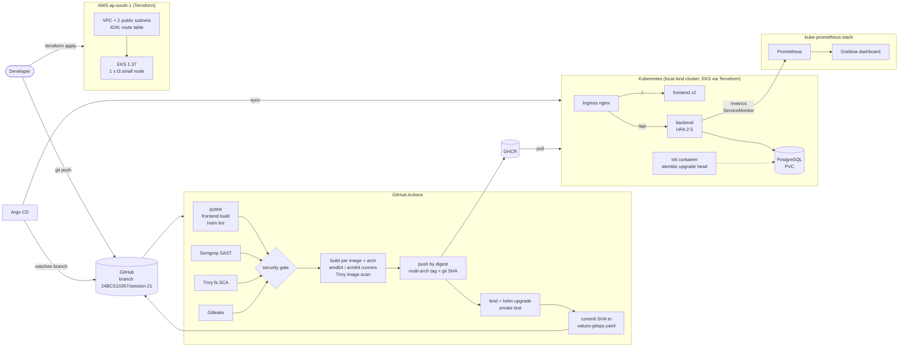

# StockPilot: Final DevOps Project

| | |
|---|---|
| Student | Ujjawal Prabhat (24BCS10267) |
| Course | DevOps Heroes, Session 21 final project |
| Branch | `24BCS10267/session-21` of `UjjawalPrabhat/devops-heros` |
| Pipeline | [`.github/workflows/24bcs10267-final-project.yml`](../../../.github/workflows/24bcs10267-final-project.yml) (repository root) |
| Images | `ghcr.io/ujjawalprabhat/stockpilot-backend`, `ghcr.io/ujjawalprabhat/stockpilot-frontend` |

Every command output in this README was copied from a real run. The complete
files are in [`docs/outputs/`](docs/outputs/). Sections marked *(pending: AWS apply)*
are not done yet and contain no results.

## Contents
1. [Project overview](#1-project-overview)
2. [Architecture](#2-architecture)
3. [Technologies](#3-technologies)
4. [Application setup](#4-application-setup)
5. [Docker setup](#5-docker-setup)
6. [Kubernetes deployment](#6-kubernetes-deployment)
7. [Helm deployment](#7-helm-deployment)
8. [Terraform infrastructure (AWS)](#8-terraform-infrastructure-aws)
9. [CI/CD pipeline](#9-cicd-pipeline)
10. [DevSecOps](#10-devsecops)
11. [Monitoring](#11-monitoring)
12. [GitOps](#12-gitops)
13. [Troubleshooting challenge](#13-troubleshooting-challenge)
14. [Screenshots](#14-screenshots)
15. [Lessons learned](#15-lessons-learned)

---

## 1. Project overview

**StockPilot** is a small inventory system for a workshop or warehouse. It
tracks SKUs, stock per location, stock movements in and out, and reorder
levels. The web UI shows KPIs (SKUs, units on hand, low-stock count, inventory
value), lists the items with a "reorder" flag and has a form to add items.

Three services:

| Service | What | Port |
|---|---|---|
| `frontend` | HTML/JS UI built with Vite, served by Nginx (non-root); proxies `/api` to the backend | 8080 in the container, 3000 in compose |
| `backend` | FastAPI REST API, SQLAlchemy, Alembic migrations, Prometheus metrics | 8000 |
| `postgres` | PostgreSQL 17, table `items` created by Alembic | 5432 |

Backend API:

| Method | Path | Purpose |
|---|---|---|
| GET | `/health` | liveness: process is up |
| GET | `/ready` | readiness: database reachable and migrated (`alembic_version` exists) |
| GET | `/metrics` | Prometheus metrics |
| GET | `/api/info` | service, version (git SHA in CI builds), environment |
| GET | `/api/items[?location=]` | list items |
| POST | `/api/items` | create (409 on duplicate SKU, 422 on invalid input) |
| GET / PUT / DELETE | `/api/items/{id}` | read / update / delete |
| POST | `/api/items/{id}/adjust` | stock movement (`delta`, cannot go below 0) |
| GET | `/api/items/low-stock` | items at or below their reorder level |
| GET | `/api/summary` | KPIs |

Interactive API docs: `http://localhost:8000/docs`.

### Folder layout

The course document names the folders `application/`, `docker/`, `kubernetes/`
and so on; the grading rubric expects `backend/`, `frontend/`, `k8s/`, `helm/`.
This project follows the rubric layout:

| Course document folder | Here |
|---|---|
| `application/` | [`backend/`](backend/) (FastAPI app, Alembic, tests) and [`frontend/`](frontend/) (UI) |
| `docker/` | [`backend/Dockerfile`](backend/Dockerfile), [`frontend/Dockerfile`](frontend/Dockerfile), [`docker-compose.yml`](docker-compose.yml) |
| `kubernetes/` | [`k8s/namespace.yaml`](k8s/namespace.yaml) and the manifests in the Helm chart templates |
| `helm/` | [`helm/stockpilot/`](helm/stockpilot/) |
| `terraform/` | [`terraform/`](terraform/) |
| `.github/workflows/` | the repository-root workflow (see below) |
| `security/` | [`security/`](security/) (Semgrep rules, Trivy and Gitleaks config, gate policy) |
| `monitoring/` | [`monitoring/`](monitoring/) (kube-prometheus-stack values); ServiceMonitor, PrometheusRule and dashboard are chart templates |
| `gitops/` | [`gitops/application.yaml`](gitops/application.yaml) (Argo CD) |
| `troubleshooting/` | [`troubleshooting/`](troubleshooting/) |
| `docs/` | [`docs/outputs/`](docs/outputs/) (captured command output) |

**Workflow location:** GitHub only runs workflows from `.github/workflows/` at the
repository root, so the pipeline lives only at
`.github/workflows/24bcs10267-final-project.yml` in the repository root. There
is no copy inside this folder.

---

## 2. Architecture



---

## 3. Technologies

| Area | Tools |
|---|---|
| Backend | Python 3.12, FastAPI 0.142.2, SQLAlchemy 2.1.3, Alembic 1.20.0, psycopg 3.3.6, prometheus-client 0.26.0 |
| Frontend | HTML/CSS/JavaScript, Vite 8.3.4 (Node 24), Nginx 1.29 (nginx-unprivileged) |
| Database | PostgreSQL 17; SQLite only for the tests |
| Tests | pytest 9.1.1, FastAPI TestClient |
| Containers | Docker, Docker Compose, multi-stage builds |
| CI/CD | GitHub Actions, GHCR |
| Security | Semgrep 1.179.0, Trivy 0.75.0, Gitleaks 8.30.1 |
| Kubernetes | kind (3 nodes, arm64, Kubernetes 1.37), ingress-nginx, metrics-server, Helm 4.3 |
| IaC | Terraform 1.16, AWS provider 6.69, Amazon EKS |
| Monitoring | kube-prometheus-stack 91.9.0 (Prometheus Operator, Prometheus, Grafana) |
| GitOps | Argo CD |

---

## 4. Application setup

Backend without Docker (needs a PostgreSQL, or falls back to a local SQLite file):

```bash
cd backend
python3.12 -m venv .venv && source .venv/bin/activate
pip install -r requirements-dev.txt
pytest -v
export DB_HOST=localhost DB_USER=stockpilot DB_PASSWORD=... DB_NAME=stockpilot
alembic upgrade head
uvicorn app.main:app --reload --port 8000
```

Frontend dev server (proxies `/api` to `localhost:8000`):

```bash
cd frontend && npm ci && npm run dev
```

Configuration is read from environment variables only (`backend/app/config.py`):
`APP_ENV`, `APP_VERSION`, `LOG_LEVEL`, `DEFAULT_REORDER_LEVEL`, `DB_HOST`, `DB_PORT`,
`DB_NAME` (ConfigMap in Kubernetes) and `DB_USER`, `DB_PASSWORD` (Secret).

**Database migrations.** The `items` table is created by Alembic
([`backend/alembic/versions/0001_create_items.py`](backend/alembic/versions/0001_create_items.py)).
`python -m app.migrate` waits for the database and runs `alembic upgrade head`.
It runs as the `migrate` service in compose and as an init container of every
backend pod in Kubernetes. A PostgreSQL advisory lock in `alembic/env.py`
serialises the init containers when several pods start at once.

**Tests.** 15 pytest cases cover health/readiness, CRUD, validation, stock
adjustments, the summary and `/metrics`. `tests/conftest.py` points the app at a
temporary SQLite file and builds the schema with the same Alembic migration, so
the tests never touch the real database. Run in a clean container
([`docs/outputs/pytest.txt`](docs/outputs/pytest.txt)):

```text
$ docker run --rm -v "$PWD/backend:/src:ro" -w /src -e PYTHONDONTWRITEBYTECODE=1 python:3.12-slim sh -c "pip install -q --root-user-action=ignore --disable-pip-version-check -r requirements-dev.txt && pytest -v -p no:cacheprovider"
============================= test session starts ==============================
platform linux -- Python 3.12.15, pytest-9.1.1, pluggy-1.7.0 -- /usr/local/bin/python3.12
rootdir: /src
configfile: pytest.ini
testpaths: tests
plugins: anyio-4.15.1, cov-7.1.0
collecting ... collected 15 items

tests/test_api.py::test_health PASSED                                    [  6%]
tests/test_api.py::test_ready_checks_database PASSED                     [ 13%]
tests/test_api.py::test_root_identifies_service PASSED                   [ 20%]
tests/test_api.py::test_info_reports_env PASSED                          [ 26%]
tests/test_api.py::test_create_and_get_item PASSED                       [ 33%]
tests/test_api.py::test_duplicate_sku_conflict PASSED                    [ 40%]
tests/test_api.py::test_invalid_sku_rejected PASSED                      [ 46%]
tests/test_api.py::test_default_reorder_level_from_config PASSED         [ 53%]
tests/test_api.py::test_list_and_filter_by_location PASSED               [ 60%]
tests/test_api.py::test_update_item PASSED                               [ 66%]
tests/test_api.py::test_adjust_stock_in_and_out PASSED                   [ 73%]
tests/test_api.py::test_adjust_stock_cannot_go_negative PASSED           [ 80%]
tests/test_api.py::test_low_stock_and_summary PASSED                     [ 86%]
tests/test_api.py::test_delete_item_and_404 PASSED                       [ 93%]
tests/test_api.py::test_metrics_exposed PASSED                           [100%]

============================== 15 passed in 0.11s ==============================
```

---

## 5. Docker setup

* [`backend/Dockerfile`](backend/Dockerfile): two stages. The builder creates a
  virtualenv; the runtime copies the venv, `alembic/` and `app/`, runs
  `apt-get upgrade`, removes pip/setuptools and runs as UID 10001.
* [`frontend/Dockerfile`](frontend/Dockerfile): stage 1 `node:24-alpine` runs
  `npm ci && npm run build`; stage 2 `nginx-unprivileged` serves `dist/` as UID
  101 on port 8080. The Nginx config is a template: `BACKEND_URL` decides where
  `/api` is proxied, and the backend name is resolved per request, so Nginx
  starts even if the backend is not resolvable yet.
* [`docker-compose.yml`](docker-compose.yml): `postgres` (with healthcheck) →
  `migrate` (one-shot, `alembic upgrade head`) → `backend` → `frontend` on
  <http://localhost:3000>.

```bash
docker compose up --build
```

Real run ([`docs/outputs/docker-compose.txt`](docs/outputs/docker-compose.txt)):

```text
$ docker compose up --build -d 2>&1 | grep -E 'Built|Started|Healthy|Exited'
 Image stockpilot-backend:compose Built 
 Image stockpilot-frontend:compose Built 
 Container final-devops-project-postgres-1 Started 
 Container final-devops-project-postgres-1 Healthy 
 Container final-devops-project-migrate-1 Started 
 Container final-devops-project-migrate-1 Exited 
 Container final-devops-project-backend-1 Started 
 Container final-devops-project-frontend-1 Started 

$ until curl -sf localhost:8000/ready && curl -sf -o /dev/null localhost:3000/; do sleep 1; done; echo
{"status":"READY"}{"status":"READY"}{"status":"READY"}

$ docker compose ps -a --format 'table {{.Service}}\t{{.Status}}\t{{.Ports}}'
SERVICE    STATUS                     PORTS
backend    Up 3 seconds               0.0.0.0:8000->8000/tcp, [::]:8000->8000/tcp
frontend   Up 3 seconds               0.0.0.0:3000->8080/tcp, [::]:3000->8080/tcp
migrate    Exited (0) 3 seconds ago   
postgres   Up 7 seconds (healthy)     5432/tcp

$ docker compose logs migrate
migrate-1  | INFO  [alembic.runtime.migration] Context impl PostgresqlImpl.
migrate-1  | INFO  [alembic.runtime.migration] Will assume transactional DDL.
migrate-1  | INFO  [alembic.runtime.migration] Running upgrade  -> 0001_create_items, create items table
migrate-1  | database schema is at head

$ curl -s localhost:8000/health
{"status":"UP"}
$ curl -s -o /dev/null -w '%{http_code} %{content_type}\n' localhost:3000/
200 text/html

$ curl -s -X POST localhost:3000/api/items -H 'Content-Type: application/json' -d '{"sku":"BOLT-M8","name":"M8 hex bolt","quantity":120}'
{"id":1,"sku":"BOLT-M8","name":"M8 hex bolt","location":"MAIN","quantity":120,"reorder_level":10,"unit_price_paise":0,"low_stock":false,"updated_at":"2026-10-20T05:02:23.290169Z"}
$ curl -s localhost:3000/api/summary
{"total_items":1,"total_units":120,"low_stock_items":0,"inventory_value_paise":0}
$ docker compose exec backend id; docker compose exec frontend id
uid=10001(app) gid=10001(app) groups=10001(app)
uid=101(nginx) gid=101(nginx) groups=101(nginx)

$ docker compose exec postgres psql -U stockpilot -d stockpilot -c '\dt'
               List of relations
 Schema |      Name       | Type  |   Owner    
--------+-----------------+-------+------------
 public | alembic_version | table | stockpilot
 public | items           | table | stockpilot
(2 rows)
```

Images used for the kind cluster ([`docs/outputs/docker-build.txt`](docs/outputs/docker-build.txt)):

```text
$ docker build --pull --no-cache -q --build-arg APP_VERSION=2.0.0 -t stockpilot-backend:2.0.0 backend
sha256:c9079046629a4701c72bbd1f7474d22f3ea8ff42e37393194612323fd7e2170a

$ docker build --pull --no-cache -q -t stockpilot-frontend:2.0.0 frontend
sha256:086b54a4ac9f2ab4fb8f954d46c4c85f13d9e5e1d1bc67d8b2fe32fe96ee4999

$ docker image ls --format 'table {{.Repository}}\t{{.Tag}}\t{{.Size}}' 'stockpilot-*:2.0.0'
REPOSITORY            TAG       SIZE
stockpilot-frontend   2.0.0     112MB
stockpilot-backend    2.0.0     306MB

$ docker run --rm --entrypoint id stockpilot-backend:2.0.0; docker run --rm --entrypoint id stockpilot-frontend:2.0.0
uid=10001(app) gid=10001(app) groups=10001(app)
uid=101(nginx) gid=101(nginx) groups=101(nginx),101(nginx)
```

---

## 6. Kubernetes deployment

Local cluster: kind `devops-heros` (1 control plane + 2 workers, arm64) with
ingress-nginx on host port 8081 and metrics-server. The objects come from the
Helm chart (section 7); [`k8s/namespace.yaml`](k8s/namespace.yaml) creates the
namespace first.

| Object | Name | Notes |
|---|---|---|
| Namespace | `final` | `k8s/namespace.yaml` |
| Deployment | `stockpilot-backend` | init container `migrate`, liveness `/health`, readiness `/ready`, requests/limits, non-root, read-only root FS, all capabilities dropped |
| Deployment | `stockpilot-frontend` | 2 replicas, probes on `/`, non-root, read-only root FS (emptyDir for the rendered config and `/tmp`) |
| Deployment + PVC | `stockpilot-postgres`, `stockpilot-pgdata` | 1 replica, `Recreate`, 1Gi PVC, `pg_isready` probes |
| Service (ClusterIP) | `stockpilot-backend`, `stockpilot-frontend`, `stockpilot-postgres` | |
| Ingress | `stockpilot` | host `stockpilot.local`: `/api` → backend, `/` → frontend |
| HPA | `stockpilot-backend` | CPU 60 %, 2 to 5 replicas |
| ConfigMap / Secret | `stockpilot-config` / `stockpilot-db` | Secret rendered only for local use (placeholder password) |
| ServiceMonitor, PrometheusRule, dashboard ConfigMap | | monitoring, section 11 |

State after the deployment ([`docs/outputs/k8s-state.txt`](docs/outputs/k8s-state.txt)):

```text
$ kubectl get pods -n final -o wide
NAME                                   READY   STATUS    RESTARTS      AGE     IP            NODE                   NOMINATED NODE   READINESS GATES
stockpilot-backend-94f54b467-6psgg     1/1     Running   0             23s     10.244.1.20   devops-heros-worker2   <none>           <none>
stockpilot-backend-94f54b467-nvjgt     1/1     Running   0             15s     10.244.2.19   devops-heros-worker    <none>           <none>
stockpilot-frontend-699d585744-2slpx   1/1     Running   0             23s     10.244.1.21   devops-heros-worker2   <none>           <none>
stockpilot-frontend-699d585744-w587r   1/1     Running   0             22s     10.244.2.18   devops-heros-worker    <none>           <none>
stockpilot-postgres-6bc5799cf7-9p7kw   1/1     Running   1 (10m ago)   3d15h   10.244.1.15   devops-heros-worker2   <none>           <none>

$ kubectl get svc -n final
NAME                  TYPE        CLUSTER-IP      EXTERNAL-IP   PORT(S)    AGE
stockpilot-backend    ClusterIP   10.96.254.111   <none>        80/TCP     3d15h
stockpilot-frontend   ClusterIP   10.96.123.94    <none>        80/TCP     3d15h
stockpilot-postgres   ClusterIP   10.96.1.113     <none>        5432/TCP   13d

$ helm list -n final
NAME      	NAMESPACE	REVISION	UPDATED                              	STATUS  	CHART           	APP VERSION
stockpilot	final    	6       	2026-10-20 13:09:54.963968 +0800 WITA	deployed	stockpilot-0.2.0	2.0.0      

$ kubectl get ingress,hpa,pvc,servicemonitor,prometheusrule -n final
NAME                                   CLASS   HOSTS              ADDRESS     PORTS   AGE
ingress.networking.k8s.io/stockpilot   nginx   stockpilot.local   localhost   80      13d

NAME                                                     REFERENCE                       TARGETS       MINPODS   MAXPODS   REPLICAS   AGE
horizontalpodautoscaler.autoscaling/stockpilot-backend   Deployment/stockpilot-backend   cpu: 6%/60%   2         5         2          3d15h

NAME                                      STATUS   VOLUME                                     CAPACITY   ACCESS MODES   STORAGECLASS   VOLUMEATTRIBUTESCLASS   AGE
persistentvolumeclaim/stockpilot-pgdata   Bound    pvc-aa28fa97-6cf7-49e1-b8ba-84ad4754aeb4   1Gi        RWO            standard       <unset>                 3d15h

NAME                                                      AGE
servicemonitor.monitoring.coreos.com/stockpilot-backend   3d15h

NAME                                                     AGE
prometheusrule.monitoring.coreos.com/stockpilot-alerts   13d

$ kubectl get ingress stockpilot -n final -o jsonpath='{range .spec.rules[0].http.paths[*]}{.path} -> {.backend.service.name}{"\n"}{end}'
/api -> stockpilot-backend
/ -> stockpilot-frontend

$ kubectl -n final logs deploy/stockpilot-backend -c migrate
Found 2 pods, using pod/stockpilot-backend-94f54b467-6psgg
INFO  [alembic.runtime.migration] Context impl PostgresqlImpl.
INFO  [alembic.runtime.migration] Will assume transactional DDL.
database schema is at head
```

Through the Ingress ([`docs/outputs/ingress-smoke.txt`](docs/outputs/ingress-smoke.txt),
script [`scripts/smoke-ingress.sh`](scripts/smoke-ingress.sh)):

```text
$ scripts/smoke-ingress.sh
$ curl -s -H 'Host: stockpilot.local' -o /dev/null -w %{http_code} %{content_type}\n localhost:8081/
200 text/html


$ curl -s -H 'Host: stockpilot.local' localhost:8081/api/info
{"service":"StockPilot","version":"2.0.0","env":"dev"}

$ curl -s -H 'Host: stockpilot.local' -X POST -H Content-Type: application/json localhost:8081/api/items -d {"sku":"SMOKE-1","name":"smoke test item","quantity":3}
{"id":7,"sku":"SMOKE-1","name":"smoke test item","location":"MAIN","quantity":3,"reorder_level":10,"unit_price_paise":0,"low_stock":true,"updated_at":"2026-10-20T05:10:20.492696Z"}

$ curl -s -H 'Host: stockpilot.local' -X PUT -H Content-Type: application/json localhost:8081/api/items/7 -d {"quantity":30}
{"id":7,"sku":"SMOKE-1","name":"smoke test item","location":"MAIN","quantity":30,"reorder_level":10,"unit_price_paise":0,"low_stock":false,"updated_at":"2026-10-20T05:10:20.556053Z"}

$ curl -s -H 'Host: stockpilot.local' localhost:8081/api/items
[{"id":1,"sku":"BOLT-M8","name":"M8 hex bolt","location":"MAIN","quantity":40,"reorder_level":50,"unit_price_paise":250,"low_stock":true,"updated_at":"2026-10-16T13:14:43.888470Z"},{"id":2,"sku":"BRG-6204","name":"6204 ball bearing","location":"WH2","quantity":6,"reorder_level":10,"unit_price_paise":18000,"low_stock":true,"updated_at":"2026-10-16T13:14:43.876557Z"},{"id":7,"sku":"SMOKE-1","name":"smoke test item","location":"MAIN","quantity":30,"reorder_level":10,"unit_price_paise":0,"low_stock":false,"updated_at":"2026-10-20T05:10:20.556053Z"}]

$ curl -s -H 'Host: stockpilot.local' -X DELETE -o /dev/null -w %{http_code}\n localhost:8081/api/items/7
204


$ curl -s -H 'Host: stockpilot.local' localhost:8081/api/summary
{"total_items":2,"total_units":46,"low_stock_items":2,"inventory_value_paise":118000}
```

### HPA under load

[`scripts/hpa-load.sh`](scripts/hpa-load.sh) runs a busybox pod with 8
parallel `wget` loops against the backend Service for 150 s
([`docs/outputs/hpa-load-test.txt`](docs/outputs/hpa-load-test.txt)):

```text
$ NS=final DURATION=150 scripts/hpa-load.sh
$ kubectl -n final get hpa
NAME                 REFERENCE                       TARGETS              MINPODS   MAXPODS   REPLICAS   AGE
stockpilot-backend   Deployment/stockpilot-backend   cpu: <unknown>/60%   2         5         2          3d15h

$ kubectl -n final run load-gen --image=busybox:1.37 --restart=Never -- sh -c '<8 parallel wget loops against http://stockpilot-backend.final.svc.cluster.local/api/summary and /api/items for 150s>'
pod/load-gen created

--- 13:10:26
stockpilot-backend   Deployment/stockpilot-backend   cpu: <unknown>/60%   2     5     2     3d15h
--- 13:10:41
stockpilot-backend   Deployment/stockpilot-backend   cpu: 103%/60%   2     5     2     3d15h
--- 13:10:56
stockpilot-backend   Deployment/stockpilot-backend   cpu: 470%/60%   2     5     4     3d15h
--- 13:11:12
stockpilot-backend   Deployment/stockpilot-backend   cpu: 862%/60%   2     5     5     3d15h
--- 13:11:27
stockpilot-backend   Deployment/stockpilot-backend   cpu: 822%/60%   2     5     5     3d15h
--- 13:11:42
stockpilot-backend   Deployment/stockpilot-backend   cpu: 180%/60%   2     5     5     3d15h
--- 13:11:57
stockpilot-backend   Deployment/stockpilot-backend   cpu: 329%/60%   2     5     5     3d15h
--- 13:12:12
stockpilot-backend   Deployment/stockpilot-backend   cpu: 541%/60%   2     5     5     3d15h
--- 13:12:27
stockpilot-backend   Deployment/stockpilot-backend   cpu: 653%/60%   2     5     5     3d15h
--- 13:12:43
stockpilot-backend   Deployment/stockpilot-backend   cpu: 268%/60%   2     5     5     3d15h
--- 13:12:58
stockpilot-backend   Deployment/stockpilot-backend   cpu: 361%/60%   2     5     5     3d15h
--- 13:13:13
stockpilot-backend   Deployment/stockpilot-backend   cpu: 428%/60%   2     5     5     3d15h
--- 13:13:28
stockpilot-backend   Deployment/stockpilot-backend   cpu: 64%/60%   2     5     5     3d15h
--- 13:13:43
stockpilot-backend   Deployment/stockpilot-backend   cpu: 7%/60%   2     5     5     3d15h

$ kubectl -n final describe hpa stockpilot-backend | grep SuccessfulRescale
  Normal   SuccessfulRescale             3m20s              horizontal-pod-autoscaler  New size: 4; reason: cpu resource utilization (percentage of request) above target
  Normal   SuccessfulRescale             3m5s               horizontal-pod-autoscaler  New size: 5; reason: cpu resource utilization (percentage of request) above target
```

---

## 7. Helm deployment

Chart [`helm/stockpilot`](helm/stockpilot) (version 0.2.0, appVersion 2.0.0).
`image.registry` + `image.tag` select both images; CI sets the tag to the git SHA.

| Values file | Used for |
|---|---|
| `values.yaml` | defaults: GHCR images, placeholder DB secret, ingress `stockpilot.local`, HPA 2 to 5, monitoring off |
| `values-dev.yaml` | local kind: images loaded with `kind load`, tag `2.0.0`, monitoring on |
| `values-gitops.yaml` | Argo CD environment: image tag written by CI, `existingSecret`, ingress `stockpilot-gitops.local` |

```bash
docker build -t stockpilot-backend:2.0.0 backend
docker build -t stockpilot-frontend:2.0.0 frontend
kind load docker-image stockpilot-backend:2.0.0 stockpilot-frontend:2.0.0 --name devops-heros
kubectl apply -f k8s/namespace.yaml
helm upgrade --install stockpilot helm/stockpilot -n final -f helm/stockpilot/values-dev.yaml --wait --timeout 5m
```

Real run ([`docs/outputs/helm-install.txt`](docs/outputs/helm-install.txt)). The
release already existed in `final` from an earlier version of the project, so
this is an upgrade. The images are rebuilt under the same local tag, so the
Deployments are restarted to pick them up:

```text
$ kind load docker-image stockpilot-backend:2.0.0 stockpilot-frontend:2.0.0 --name devops-heros
Image: "stockpilot-backend:2.0.0" with ID "sha256:c9079046629a4701c72bbd1f7474d22f3ea8ff42e37393194612323fd7e2170a" not yet present on node "devops-heros-control-plane", loading...
Image: "stockpilot-backend:2.0.0" with ID "sha256:c9079046629a4701c72bbd1f7474d22f3ea8ff42e37393194612323fd7e2170a" not yet present on node "devops-heros-worker", loading...
Image: "stockpilot-backend:2.0.0" with ID "sha256:c9079046629a4701c72bbd1f7474d22f3ea8ff42e37393194612323fd7e2170a" not yet present on node "devops-heros-worker2", loading...
Image: "stockpilot-frontend:2.0.0" with ID "sha256:086b54a4ac9f2ab4fb8f954d46c4c85f13d9e5e1d1bc67d8b2fe32fe96ee4999" not yet present on node "devops-heros-control-plane", loading...
Image: "stockpilot-frontend:2.0.0" with ID "sha256:086b54a4ac9f2ab4fb8f954d46c4c85f13d9e5e1d1bc67d8b2fe32fe96ee4999" not yet present on node "devops-heros-worker", loading...
Image: "stockpilot-frontend:2.0.0" with ID "sha256:086b54a4ac9f2ab4fb8f954d46c4c85f13d9e5e1d1bc67d8b2fe32fe96ee4999" not yet present on node "devops-heros-worker2", loading...

$ kubectl apply -f k8s/namespace.yaml
namespace/final unchanged

$ helm upgrade --install stockpilot helm/stockpilot -n final -f helm/stockpilot/values-dev.yaml --wait --timeout 5m
Release "stockpilot" has been upgraded. Happy Helming!
NAME: stockpilot
LAST DEPLOYED: Tue Oct 20 13:09:54 2026
NAMESPACE: final
STATUS: deployed
REVISION: 6
DESCRIPTION: Upgrade complete
TEST SUITE: None
NOTES:
StockPilot 2.0.0 deployed to namespace final.

  kubectl -n final get pods,svc,ingress,hpa,pvc
  curl -H 'Host: stockpilot.local' http://localhost:8081/api/summary   # kind: ingress-nginx on host port 8081

$ kubectl -n final rollout restart deploy/stockpilot-backend deploy/stockpilot-frontend && kubectl -n final rollout status deploy/stockpilot-backend --timeout=180s && kubectl -n final rollout status deploy/stockpilot-frontend --timeout=180s
deployment.apps/stockpilot-backend restarted
deployment.apps/stockpilot-frontend restarted
Waiting for deployment "stockpilot-backend" rollout to finish: 1 out of 2 new replicas have been updated...
Waiting for deployment "stockpilot-backend" rollout to finish: 1 out of 2 new replicas have been updated...
Waiting for deployment "stockpilot-backend" rollout to finish: 1 out of 2 new replicas have been updated...
Waiting for deployment "stockpilot-backend" rollout to finish: 1 old replicas are pending termination...
Waiting for deployment "stockpilot-backend" rollout to finish: 1 old replicas are pending termination...
Waiting for deployment "stockpilot-backend" rollout to finish: 1 old replicas are pending termination...
deployment "stockpilot-backend" successfully rolled out
deployment "stockpilot-frontend" successfully rolled out
```

---

## 8. Terraform infrastructure (AWS)

[`terraform/`](terraform/) provisions, in `ap-south-1`:

| File | Resources |
|---|---|
| `network.tf` | VPC `10.40.0.0/16`, internet gateway, 2 public subnets in the first 2 available AZs (`data.aws_availability_zones`), public route table + associations |
| `eks.tf` | IAM role for the cluster (`AmazonEKSClusterPolicy`), IAM role for nodes (worker, CNI, ECR read-only policies), EKS cluster 1.37 (API access entries; the caller becomes admin), managed node group: 1 x `t3.small`, 20 GiB disk |
| `outputs.tf` | cluster name, endpoint, VPC id, subnet ids, `aws eks update-kubeconfig` command |
| `terraform.tfvars.example` | example variables, no credentials |

No NAT gateway: the node runs in a public subnet with a public IP and reaches
the EKS endpoint and image registries through the internet gateway. State is
local (`terraform.tfstate`, git-ignored); `.terraform.lock.hcl` is committed.

Estimated cost while it exists (on-demand prices for ap-south-1 from the AWS
Price List API): EKS control plane $0.10/h + t3.small $0.0224/h + one in-use
public IPv4 $0.005/h + 20 GiB EBS (about $0.003/h) ≈ **$0.13 per hour**.

```bash
cd terraform
terraform init
terraform plan -out tfplan
terraform apply tfplan
aws eks update-kubeconfig --region ap-south-1 --name stockpilot-eks
terraform destroy
```

`fmt`, `init` and `validate` ([`docs/outputs/terraform-init-validate.txt`](docs/outputs/terraform-init-validate.txt)):

```text
$ cd terraform && terraform fmt -check -recursive && echo 'fmt: OK'
fmt: OK

$ cd terraform && terraform init -no-color
Initializing the backend...

Initializing provider plugins...
- Reusing previous version of hashicorp/aws from the dependency lock file
- Using previously-installed hashicorp/aws v6.69.1

Terraform has been successfully initialized!

You may now begin working with Terraform. Try running "terraform plan" to see
any changes that are required for your infrastructure. All Terraform commands
should now work.

If you ever set or change modules or backend configuration for Terraform,
rerun this command to reinitialize your working directory. If you forget, other
commands will detect it and remind you to do so if necessary.

$ cd terraform && terraform validate -no-color
Success! The configuration is valid.
```

### terraform plan (pending: AWS apply)

The AWS account is new and not activated yet: EC2 calls return `OptInRequired`
("You are not subscribed to this service") and EKS calls return
`SubscriptionRequiredException`, so `terraform plan` cannot read the
availability zones. Plan output will be added here once the account is active.

### terraform apply, AWS console and destroy (pending: AWS apply)

---

## 9. CI/CD pipeline

Workflow: `.github/workflows/24bcs10267-final-project.yml` (repository root).

Triggers: `push` to `main` and `24BCS10267/session-21`, `pull_request` to
`main`, and `workflow_dispatch`. All are filtered to this project folder and the
workflow file (Markdown-only changes are excluded), so other students' work in
the same repository does not start it.

| Job | What it does |
|---|---|
| `test` | `pytest -v`, frontend `npm ci && npm run build`, `helm lint` (3 value sets) |
| `sast` | Semgrep (see section 10) |
| `sca` | Trivy fs on `requirements.txt` and `package-lock.json` |
| `secret-scan` | Gitleaks on the project folder |
| `security-gate` | needs the 4 jobs above; fails unless all succeeded |
| `build` (matrix) | backend and frontend × amd64 (`ubuntu-24.04`) and arm64 (`ubuntu-24.04-arm`): build, **Trivy image scan (fails on fixable HIGH/CRITICAL)**, then push by digest (untagged) |
| `publish` (matrix) | `docker buildx imagetools create`: one multi-arch image per component tagged with the **full git SHA** |
| `deploy` | kind cluster in the runner, `helm upgrade --install` with the SHA images, smoke test frontend → `/api` → backend → PostgreSQL and `/metrics` |
| `gitops-promote` | only on push to `24BCS10267/session-21`: writes the SHA into `helm/stockpilot/values-gitops.yaml` and commits it |

* The test job gates everything: no image is built if a test fails.
* Image names come from the lowercased `github.repository_owner`, and push,
  publish and promote run only on push events (pull requests from forks have a
  read-only token). There are no `latest` tags.
* Both architectures are built natively (no QEMU), because the Argo CD target
  is the arm64 kind cluster and GitHub runners / EKS nodes are amd64.

`actionlint` on the workflow ([`docs/outputs/actionlint.txt`](docs/outputs/actionlint.txt)):

```text
# run from the repository root
$ docker run --rm -v "$PWD:/repo" -w /repo rhysd/actionlint:1.7.12 -no-color .github/workflows/24bcs10267-final-project.yml && echo "actionlint: no problems found"
Unable to find image 'rhysd/actionlint:1.7.12' locally
1.7.12: Pulling from rhysd/actionlint
Digest: sha256:b1934ee5f1c509618f2508e6eb47ee0d3520686341fec936f3b79331f9315667
Status: Downloaded newer image for rhysd/actionlint:1.7.12
actionlint: no problems found
```

### Pipeline run

Run [39379996571](https://github.com/UjjawalPrabhat/devops-heros/actions/runs/39379996571)
(push of commit `a6a18fe` to `24BCS10267/session-21`): all 13 jobs succeeded.
Excerpts from the run log ([`docs/outputs/ci-run-39379996571.txt`](docs/outputs/ci-run-39379996571.txt)):

```text
$ gh run view 39379996571 -R UjjawalPrabhat/devops-heros --json url,event,headBranch,headSha,conclusion --jq '.url, .event+" "+.headBranch+" "+.headSha, .conclusion'
https://github.com/UjjawalPrabhat/devops-heros/actions/runs/39379996571
push 24BCS10267/session-21 a6a18febabde5e45bc4cdc026626eb9fe6841949
success

$ gh run view 39379996571 -R UjjawalPrabhat/devops-heros --json jobs --jq '.jobs[] | .conclusion+"  "+.name'
success  SAST (Semgrep)
success  SCA (Trivy fs)
success  Secret scan (Gitleaks)
success  Test (pytest) + frontend build + helm lint
success  Security gate
success  Build + Trivy backend (amd64)
success  Build + Trivy frontend (amd64)
success  Build + Trivy frontend (arm64)
success  Build + Trivy backend (arm64)
success  Publish backend:<git sha> to GHCR
success  Publish frontend:<git sha> to GHCR
success  Deploy with Helm to kind + smoke test
success  Promote to GitOps (values-gitops.yaml)
```

```text
$ awk -F'\t' '$2=="pytest" && /passed in/ {print substr($3,30)}' run.log
============================== 15 passed in 0.26s ==============================

$ awk -F'\t' '$1=="Security gate" && $3 ~ /Z (test|sast|sca|secret-scan)=|Gate passed$/ {print substr($3,30)}' run.log
test=success
sast=success
sca=success
secret-scan=success
Gate passed

$ awk -F'\t' '$1 ~ /^Deploy/ && $3 ~ /Z \+ curl|STATUS: deployed/ {print substr($3,30,110)}' run.log
STATUS: deployed
+ curl -sf localhost:8080/
+ curl -sf localhost:8080/api/info
+ curl -sf -X POST localhost:8080/api/items -H 'Content-Type: application/json' -d '{"sku":"CI-SMOKE","name":"
+ curl -sf localhost:8080/api/items/low-stock
+ curl -sf localhost:8000/ready
+ curl -sf localhost:8000/metrics
```

### GHCR images with SHA tags

Both images are public multi-arch indexes tagged only with the full commit SHA.
Checked without logging in ([`docs/outputs/ghcr-images.txt`](docs/outputs/ghcr-images.txt)):

```text
# no docker login: the packages are public
$ docker logout ghcr.io >/dev/null 2>&1; docker buildx imagetools inspect ghcr.io/ujjawalprabhat/stockpilot-backend:a6a18febabde5e45bc4cdc026626eb9fe6841949
Name:      ghcr.io/ujjawalprabhat/stockpilot-backend:a6a18febabde5e45bc4cdc026626eb9fe6841949
MediaType: application/vnd.oci.image.index.v1+json
Digest:    sha256:93459a8a4fb3d0d7a965dabb44efa4888b8d24b731e05789b25a75d18262881a
           
Manifests: 
  Name:      ghcr.io/ujjawalprabhat/stockpilot-backend:a6a18febabde5e45bc4cdc026626eb9fe6841949@sha256:8fc10a9f39804a7cba4756882c7ed80f84822455cbd71231953a507d246ebf1c
  MediaType: application/vnd.oci.image.manifest.v1+json
  Platform:  linux/amd64
             
  Name:      ghcr.io/ujjawalprabhat/stockpilot-backend:a6a18febabde5e45bc4cdc026626eb9fe6841949@sha256:f8cfd4a4335e0a3bed31307dd69f55b8eaf0cc9e742e8cedbe7ca239cc6cf04a
  MediaType: application/vnd.oci.image.manifest.v1+json
  Platform:  linux/arm64

$ docker buildx imagetools inspect ghcr.io/ujjawalprabhat/stockpilot-frontend:a6a18febabde5e45bc4cdc026626eb9fe6841949
Name:      ghcr.io/ujjawalprabhat/stockpilot-frontend:a6a18febabde5e45bc4cdc026626eb9fe6841949
MediaType: application/vnd.oci.image.index.v1+json
Digest:    sha256:a395371fa56987cbb2b2fb027aab36659ff9ed2449545935c19164797eb7d738
           
Manifests: 
  Name:      ghcr.io/ujjawalprabhat/stockpilot-frontend:a6a18febabde5e45bc4cdc026626eb9fe6841949@sha256:99d43ab07b2cbf970551dd6d08c6da414dd5249aefb408d837ad7cf6e6178c89
  MediaType: application/vnd.oci.image.manifest.v1+json
  Platform:  linux/amd64
             
  Name:      ghcr.io/ujjawalprabhat/stockpilot-frontend:a6a18febabde5e45bc4cdc026626eb9fe6841949@sha256:a4ed4cd85f8a2018a7d4643fb707e6b966b5c9bd8b0441041e72090d85167543
  MediaType: application/vnd.oci.image.manifest.v1+json
  Platform:  linux/arm64
```

---

## 10. DevSecOps

Policy: [`security/SECURITY-GATE.md`](security/SECURITY-GATE.md).

| Layer | Tool | Config |
|---|---|---|
| SAST | Semgrep (`p/python`, `p/javascript`, `p/dockerfile`, `p/secrets` + 4 custom rules) | [`security/semgrep.yml`](security/semgrep.yml) |
| SCA | Trivy fs | [`security/trivy.yaml`](security/trivy.yaml) |
| Secrets | Gitleaks (default rules) | [`security/gitleaks.toml`](security/gitleaks.toml) |
| Container images | Trivy image, both images, both architectures | [`security/trivy.yaml`](security/trivy.yaml) |
| Gate | `security-gate` job + Trivy step before every push | workflow |

**What Trivy scans and what the result means.** Trivy checks every OS package
(Debian 13 in the backend, Alpine 3.23 in the frontend) and every Python/npm
library inside the image against its vulnerability database. The pipeline runs
it with `--severity HIGH,CRITICAL --ignore-unfixed --exit-code 1`: a HIGH or
CRITICAL finding that has a fixed version fails the job and nothing is pushed.
Findings without any fix are not blocking, because rebuilding cannot remove
them; the backend still carries 44 such HIGH findings from Debian 13.

**One CVE found.** The base image `nginxinc/nginx-unprivileged:1.29-alpine`
had 44 fixable HIGH findings, for example **CVE-2026-11352** in curl/libcurl
8.17.0-r1 (remote denial of service, fixed in 8.22.0-r0). The frontend image
does not use curl, but the package was installed. The fix is `apk upgrade` in
the runtime stage, after which the frontend image has 0 HIGH/CRITICAL findings.
While re-checking, a locally cached `apk upgrade` layer from 4 days earlier
left a newly fixed libexpat CVE (CVE-2026-77214) in the image; rebuilding with
`--no-cache` removed it. CI runners start without a layer cache, so they always
fetch current packages.

Local scans with the same configuration as CI ([`docs/outputs/trivy-images.txt`](docs/outputs/trivy-images.txt),
[`docs/outputs/security-scans.txt`](docs/outputs/security-scans.txt)):

```text
$ docker run --rm -v /var/run/docker.sock:/var/run/docker.sock -v "$PWD:/src" -w /src aquasec/trivy:0.75.0 image --config security/trivy.yaml --quiet stockpilot-backend:2.0.0 | grep -E 'Target|debian'; echo "exit code: ${PIPESTATUS[0]}"
│                                      Target                                      │    Type    │ Vulnerabilities │
│ stockpilot-backend:2.0.0 (debian 13.7)                                           │   debian   │        0        │
exit code: 0

$ docker run --rm -v /var/run/docker.sock:/var/run/docker.sock -v "$PWD:/src" -w /src aquasec/trivy:0.75.0 image --config security/trivy.yaml --quiet stockpilot-frontend:2.0.0; echo "exit code: $?"

Report Summary

┌───────────────────────────────────────────┬────────┬─────────────────┐
│                  Target                   │  Type  │ Vulnerabilities │
├───────────────────────────────────────────┼────────┼─────────────────┤
│ stockpilot-frontend:2.0.0 (alpine 3.23.4) │ alpine │        0        │
└───────────────────────────────────────────┴────────┴─────────────────┘
Legend:
- '-': Not scanned
- '0': Clean (no security findings detected)

exit code: 0

$ docker run --rm -v /var/run/docker.sock:/var/run/docker.sock -v "$PWD:/src" -w /src aquasec/trivy:0.75.0 image --config security/trivy.yaml --quiet nginxinc/nginx-unprivileged:1.29-alpine | grep -E 'Total|curl ' | head -3; echo "exit code: ${PIPESTATUS[0]}"
Total: 44 (HIGH: 44, CRITICAL: 0)
│ curl       │ CVE-2026-11352  │          │        │ 8.17.0-r1         │ 8.22.0-r0     │ curl: libcurl: curl/libcurl: Remote denial of service via    │
│ libcurl    │ CVE-2026-11352  │          │        │ 8.17.0-r1         │ 8.22.0-r0     │ curl: libcurl: curl/libcurl: Remote denial of service via    │
exit code: 1

$ docker run --rm -v /var/run/docker.sock:/var/run/docker.sock -v "$PWD:/src" -w /src aquasec/trivy:0.75.0 image --severity HIGH,CRITICAL --scanners vuln --quiet stockpilot-backend:2.0.0 | grep -E '^Total'
Total: 44 (HIGH: 44, CRITICAL: 0)

$ docker run --rm -v /var/run/docker.sock:/var/run/docker.sock -v "$PWD:/src" -w /src aquasec/trivy:0.75.0 image --severity HIGH,CRITICAL --scanners vuln --quiet stockpilot-frontend:2.0.0 | grep -E '^Total'
```

```text
$ docker run --rm -v "$PWD:/src" -w /src semgrep/semgrep:1.179.0 semgrep scan --metrics=off --disable-version-check --error --config p/python --config p/javascript --config p/dockerfile --config p/secrets --config security/semgrep.yml backend frontend 2>&1 | grep -E 'Findings|Rules run|Targets scanned|Ran '
 • Findings: 0 (0 blocking)
 • Rules run: 266
 • Targets scanned: 39
Ran 266 rules on 39 files: 0 findings.

$ docker run --rm -v "$PWD:/src" -w /src aquasec/trivy:0.75.0 fs --config security/trivy.yaml --quiet .; echo "exit code: $?"

Report Summary

┌────────────────────────────┬──────┬─────────────────┐
│           Target           │ Type │ Vulnerabilities │
├────────────────────────────┼──────┼─────────────────┤
│ backend/requirements.txt   │ pip  │        0        │
├────────────────────────────┼──────┼─────────────────┤
│ frontend/package-lock.json │ npm  │        0        │
└────────────────────────────┴──────┴─────────────────┘
Legend:
- '-': Not scanned
- '0': Clean (no security findings detected)

exit code: 0

$ docker run --rm -v "$PWD:/src" ghcr.io/gitleaks/gitleaks:v8.30.1 dir /src --config /src/security/gitleaks.toml --redact --no-banner --no-color; echo "exit code: $?"
5:34AM INF scanned ~306889 bytes (306.89 KB) in 59.8ms
5:34AM INF no leaks found
exit code: 0
```

Custom Semgrep rules, all four run against a deliberately bad file
([`docs/outputs/semgrep-custom-rules-negative-test.txt`](docs/outputs/semgrep-custom-rules-negative-test.txt)):
`stockpilot-no-raw-sql-fstring`, `stockpilot-no-hardcoded-db-password`,
`stockpilot-no-wildcard-cors-with-credentials` and `stockpilot-no-debug-uvicorn`
each reported their line (4 findings).

### Trivy in the pipeline

Each of the four build jobs scanned the image it had just built, before pushing
it. All reported 0 fixable HIGH/CRITICAL findings, and the SCA job found none in
the dependency files:

```text
$ awk -F'\t' '$2 ~ /^Trivy image scan/ && /│ stockpilot-/ {print $1 ":  " substr($3,30)}' run.log
Build + Trivy backend (amd64):  │ stockpilot-backend:scan (debian 13.7)                                            │   debian   │        0        │
Build + Trivy frontend (amd64):  │ stockpilot-frontend:scan (alpine 3.23.4) │ alpine │        0        │
Build + Trivy frontend (arm64):  │ stockpilot-frontend:scan (alpine 3.23.4) │ alpine │        0        │
Build + Trivy backend (arm64):  │ stockpilot-backend:scan (debian 13.7)                                            │   debian   │        0        │

$ awk -F'\t' '$1=="SCA (Trivy fs)" && /│ (backend|frontend)\// {print substr($3,30)}' run.log
│ backend/requirements.txt   │ pip  │        0        │
│ frontend/package-lock.json │ npm  │        0        │
```

---

## 11. Monitoring

Prometheus and Grafana come from the kube-prometheus-stack release `kps` in
namespace `monitoring`, which I installed in Session 20. Its values are in
[`monitoring/kube-prometheus-stack-values.yaml`](monitoring/kube-prometheus-stack-values.yaml):
the `*SelectorNilUsesHelmValues: false` settings make Prometheus pick up
ServiceMonitors and rules from every namespace. The Grafana admin password is
not in Git; read it from the release Secret:

```bash
kubectl -n monitoring get secret kps-grafana -o jsonpath='{.data.admin-password}' | base64 -d
kubectl -n monitoring port-forward svc/kps-grafana 3000:80
kubectl -n monitoring port-forward svc/kps-kube-prometheus-stack-prometheus 9090:9090
```

The chart adds (when `monitoring.*.enabled`):
* **ServiceMonitor** `stockpilot-backend`: scrapes `/metrics` on every backend pod every 15 s.
* **PrometheusRule** `stockpilot-alerts`: recording rule `stockpilot:http_requests:rate5m`
  and alerts for backend down, 5xx ratio > 5 %, p95 latency > 500 ms, low stock, restarts.
* **Grafana dashboard** "StockPilot (&lt;namespace&gt;)" (ConfigMap picked up by the
  Grafana sidecar): healthy targets, request rate, low-stock SKUs, 5xx ratio,
  requests by route, p50/p95 latency, pod CPU, stock movements.

Backend metrics ([`docs/outputs/backend-metrics.txt`](docs/outputs/backend-metrics.txt)):

```text
$ kubectl -n final port-forward svc/stockpilot-backend 18000:80 &

$ curl -s localhost:18000/metrics | grep -E '^stockpilot_(http_requests_total|low_stock|stock_adj|build)'
stockpilot_http_requests_total{method="GET",route="/ready",status="200"} 51.0
stockpilot_http_requests_total{method="GET",route="/health",status="200"} 25.0
stockpilot_http_requests_total{method="GET",route="/api/info",status="200"} 1.0
stockpilot_http_requests_total{method="POST",route="/api/items",status="201"} 1.0
stockpilot_http_requests_total{method="GET",route="/api/items",status="200"} 11404.0
stockpilot_http_requests_total{method="DELETE",route="/api/items/{item_id}",status="204"} 1.0
stockpilot_http_requests_total{method="GET",route="/api/summary",status="200"} 11310.0
stockpilot_low_stock_items 2.0
stockpilot_build_info{env="dev",version="2.0.0"} 1.0
```

Prometheus targets and queries right after the HPA load test
([`docs/outputs/prometheus.txt`](docs/outputs/prometheus.txt), script
[`scripts/prom-check.sh`](scripts/prom-check.sh)):

```text
$ kubectl -n monitoring port-forward svc/kps-kube-prometheus-stack-prometheus 19090:9090 &

$ scripts/prom-check.sh
$ curl -s http://localhost:19090/api/v1/targets  (filtered: namespace=final)
   serviceMonitor/final/stockpilot-backend/0 http://10.244.1.20:8000/metrics health=up lastScrape=2026-10-20T05:14:15
   serviceMonitor/final/stockpilot-backend/0 http://10.244.2.19:8000/metrics health=up lastScrape=2026-10-20T05:14:15
   serviceMonitor/final/stockpilot-backend/0 http://10.244.1.23:8000/metrics health=up lastScrape=2026-10-20T05:14:06
   serviceMonitor/final/stockpilot-backend/0 http://10.244.2.20:8000/metrics health=up lastScrape=2026-10-20T05:14:05
   serviceMonitor/final/stockpilot-backend/0 http://10.244.1.24:8000/metrics health=up lastScrape=2026-10-20T05:14:08

$ curl -s http://localhost:19090/api/v1/query --data-urlencode 'query=up{namespace="final"}'
  {__name__="up",job="stockpilot-backend",pod="stockpilot-backend-94f54b467-6psgg"} => 1
  {__name__="up",job="stockpilot-backend",pod="stockpilot-backend-94f54b467-nvjgt"} => 1
  {__name__="up",job="stockpilot-backend",pod="stockpilot-backend-94f54b467-chvdm"} => 1
  {__name__="up",job="stockpilot-backend",pod="stockpilot-backend-94f54b467-hf4vf"} => 1
  {__name__="up",job="stockpilot-backend",pod="stockpilot-backend-94f54b467-hpdc9"} => 1
  (5 series)

$ curl -s http://localhost:19090/api/v1/query --data-urlencode 'query=sum by (route) (rate(stockpilot_http_requests_total{namespace="final"}[2m]))'
  {route="/ready"} => 0.9999980952562356
  {route="/health"} => 0.49523709751517103
  {route="/api/info"} => 0
  {route="/api/items"} => 75.49509324400992
  {route="/api/items/{item_id}"} => 0
  {route="/api/summary"} => 75.57128961583585
  (6 series)

$ curl -s http://localhost:19090/api/v1/query --data-urlencode 'query=histogram_quantile(0.95, sum by (le) (rate(stockpilot_http_request_duration_seconds_bucket{namespace="final"}[5m])))'
  {} => 0.012037001523213447
  (1 series)

$ curl -s http://localhost:19090/api/v1/query --data-urlencode 'query=max(stockpilot_low_stock_items{namespace="final"})'
  {} => 2
  (1 series)

$ curl -s http://localhost:19090/api/v1/query --data-urlencode 'query=sum by (direction) (stockpilot_stock_adjustments_total{namespace="final"})'
  (0 series)

$ curl -s http://localhost:19090/api/v1/query --data-urlencode 'query=stockpilot:http_requests:rate5m{namespace="final",status="200"}'
  {__name__="stockpilot:http_requests:rate5m",route="/ready",status="200"} => 0.780663334833275
  {__name__="stockpilot:http_requests:rate5m",route="/health",status="200"} => 0.3910215462045163
  {__name__="stockpilot:http_requests:rate5m",route="/api/info",status="200"} => 0
  {__name__="stockpilot:http_requests:rate5m",route="/api/items",status="200"} => 161.7478726112743
  {__name__="stockpilot:http_requests:rate5m",route="/api/summary",status="200"} => 161.9739215025966
  {__name__="stockpilot:http_requests:rate5m",route="/api/items/{item_id}",status="200"} => 0
  (6 series)

$ curl -s http://localhost:19090/api/v1/rules  (group stockpilot.rules)
  file: /etc/prometheus/rules/prometheus-kps-kube-prometheus-stack-prometheus-rulefiles-0/final-gitops-stockpilot-alerts-2b5ed713-ce5f-4369-961d-35685421b784.yaml
  - recording stockpilot:http_requests:rate5m health=ok  state=-
  - alerting  StockPilotApiDown            health=ok  state=inactive
  - alerting  StockPilotHighErrorRate      health=ok  state=inactive
  - alerting  StockPilotHighLatencyP95     health=ok  state=inactive
  - alerting  StockPilotLowStockItems      health=ok  state=inactive
  - alerting  StockPilotPodRestarting      health=ok  state=inactive
  file: /etc/prometheus/rules/prometheus-kps-kube-prometheus-stack-prometheus-rulefiles-0/final-stockpilot-alerts-78617cd9-0c13-435a-bb6f-de7cf3d1154a.yaml
  - recording stockpilot:http_requests:rate5m health=ok  state=-
  - alerting  StockPilotApiDown            health=ok  state=inactive
  - alerting  StockPilotHighErrorRate      health=ok  state=inactive
  - alerting  StockPilotHighLatencyP95     health=ok  state=inactive
  - alerting  StockPilotLowStockItems      health=ok  state=firing
  - alerting  StockPilotPodRestarting      health=ok  state=inactive

$ curl -s http://localhost:19090/api/v1/alerts  (StockPilot alerts)
   StockPilotLowStockItems  firing value=2e+00 - 2 SKU(s) need reordering.
```

Grafana: the dashboard was imported and every panel query returns data
([`docs/outputs/grafana.txt`](docs/outputs/grafana.txt), script
[`scripts/grafana-check.sh`](scripts/grafana-check.sh)):

```text
$ kubectl -n monitoring port-forward svc/kps-grafana 13000:80 &

$ scripts/grafana-check.sh
$ curl -s -u admin:*** 'http://localhost:13000/api/search?tag=stockpilot'
[
    {
        "id": 4246512556322816,
        "uid": "stockpilot-final",
        "orgId": 1,
        "title": "StockPilot (final)",
        "uri": "db/stockpilot-final",
        "url": "/d/stockpilot-final/stockpilot-final",
        "slug": "",
        "type": "dash-db",
        "tags": [
            "24bcs10267",
            "stockpilot"
        ],
        "isStarred": false,
        "sortMeta": 0,
        "isDeleted": false
    },
    {
        "id": 4253980883693568,
        "uid": "stockpilot-final-gitops",
        "orgId": 1,
        "title": "StockPilot API (final-gitops)",
        "uri": "db/stockpilot-api-final-gitops",
        "url": "/d/stockpilot-final-gitops/stockpilot-api-final-gitops",
        "slug": "",
        "type": "dash-db",
        "tags": [
            "24bcs10267",
            "stockpilot"
        ],
        "isStarred": false,
        "sortMeta": 0,
        "isDeleted": false
    }
]

$ curl -s -u admin:*** http://localhost:13000/api/dashboards/uid/stockpilot-final  (panel list)
  title: StockPilot (final)
  - [stat] Healthy backend targets
  - [stat] Request rate (req/s)
  - [stat] Low-stock SKUs
  - [stat] 5xx ratio (5m)
  - [timeseries] Requests per second by route
  - [timeseries] Latency p50 / p95
  - [timeseries] Pod CPU (cores)
  - [timeseries] Stock movements per minute

Evaluating each panel query through Grafana's datasource proxy (datasource uid=prometheus):
  Healthy backend targets             1 series  value=5
  Request rate (req/s)                1 series  value=1.49
  Low-stock SKUs                      1 series  value=2
  5xx ratio (5m)                      1 series  value=0
  Requests per second by route   {{ro 6 series  /ready=1, /health=0.489, /api/info=0, /api/items=0
  Latency p50 / p95              p50  1 series  value=0.00288
  Latency p50 / p95              p95  1 series  value=0.012
  Pod CPU (cores)                {{po 5 series  stockpilot-backend-94f54b467-6psgg=0.063, stockpilot-backend-94f54b467-nvjgt=0.0593, stockpilot-backend-94f54b
  Stock movements per minute     {{di 0 series  
```

Logs: the backend logs to stdout (`kubectl -n final logs deploy/stockpilot-backend`,
`-c migrate` for the migration); Uvicorn access logs are off because the
request metrics replace them.

---

## 12. GitOps

[`gitops/application.yaml`](gitops/application.yaml) is an Argo CD
`Application` that renders `helm/stockpilot` with `values-gitops.yaml` from
branch `24BCS10267/session-21` into namespace `final-gitops`, with automated
sync, `prune` and `selfHeal`. The database Secret is created outside Git by
[`scripts/gitops-bootstrap.sh`](scripts/gitops-bootstrap.sh).

How a commit reaches the cluster:

1. Push a change to `24BCS10267/session-21`.
2. The pipeline tests, scans, builds and pushes `stockpilot-backend:<sha>` and
   `stockpilot-frontend:<sha>`.
3. Job `gitops-promote` commits `image.tag: <sha>` to `values-gitops.yaml`
   (a commit made with `GITHUB_TOKEN` does not start another run).
4. Argo CD sees the new commit and rolls out the new images.

Both GHCR packages are public (published from this public repository), so the
cluster pulls them without credentials (see the anonymous `imagetools inspect` above).

### Argo CD sync of a pipeline-built SHA

The promote job of run 39379996571 committed the new tag as `ee4c529`
([`docs/outputs/ghcr-images.txt`](docs/outputs/ghcr-images.txt)):

```text
$ awk -F'\t' '$1 ~ /^Promote/ && $3 ~ /Z [-+]  tag:|Z \[24BCS10267/ {print substr($3,30)}' run.log
-  tag: pending-first-ci-run
+  tag: a6a18febabde5e45bc4cdc026626eb9fe6841949
[24BCS10267/session-21 ee4c529] gitops: promote stockpilot images to a6a18fe
```

```text
$ git log -1 --format='%h %an: %s' ee4c529
ee4c529 github-actions[bot]: gitops: promote stockpilot images to a6a18fe

$ git show ee4c529 --format= -- helm/stockpilot/values-gitops.yaml
diff --git a/session21-python/24BCS10267-ujjawal-prabhat/final-devops-project/helm/stockpilot/values-gitops.yaml b/session21-python/24BCS10267-ujjawal-prabhat/final-devops-project/helm/stockpilot/values-gitops.yaml
index 74fe3c4..f5dabd2 100644
--- a/session21-python/24BCS10267-ujjawal-prabhat/final-devops-project/helm/stockpilot/values-gitops.yaml
+++ b/session21-python/24BCS10267-ujjawal-prabhat/final-devops-project/helm/stockpilot/values-gitops.yaml
@@ -1,7 +1,7 @@
 # Argo CD environment (Application final-stockpilot-24bcs10267, namespace final-gitops).
 # image.tag is rewritten by the CI job "gitops-promote" after both images are pushed.
 image:
-  tag: pending-first-ci-run
+  tag: a6a18febabde5e45bc4cdc026626eb9fe6841949
 
 config:
   APP_ENV: gitops
```

The Argo CD Application of the previous project layout (value file
`values-prod.yaml`, which no longer exists) was deleted and the environment
bootstrapped again ([`docs/outputs/gitops-argocd.txt`](docs/outputs/gitops-argocd.txt)):

```text
# remove the Argo CD app of the previous layout (finalizer prunes its resources)
$ kubectl -n argocd delete application final-stockpilot-24bcs10267 --wait=true --timeout=180s
application.argoproj.io "final-stockpilot-24bcs10267" deleted from argocd namespace

# leftovers of the old release: PVC (resource-policy keep) and the old out-of-band Secret
$ kubectl -n final-gitops delete pvc stockpilot-postgres-data && kubectl -n final-gitops delete secret stockpilot-db-prod
persistentvolumeclaim "stockpilot-postgres-data" deleted from final-gitops namespace
secret "stockpilot-db-prod" deleted from final-gitops namespace

$ scripts/gitops-bootstrap.sh
$ kubectl create namespace final-gitops
Error from server (AlreadyExists): namespaces "final-gitops" already exists

$ kubectl -n final-gitops create secret generic stockpilot-db-gitops --from-literal=DB_USER=stockpilot --from-literal=DB_PASSWORD="$(openssl rand -hex 16)"
secret/stockpilot-db-gitops created

$ kubectl apply -f gitops/application.yaml
Warning: metadata.finalizers: "resources-finalizer.argocd.argoproj.io": prefer a domain-qualified finalizer name including a path (/) to avoid accidental conflicts with other finalizer writers
application.argoproj.io/final-stockpilot-24bcs10267 created
```

After Argo CD finished the sync (polled until `Synced/Healthy`), the
environment runs the images of commit `a6a18fe` at Git revision `ee4c529`:

```text
# (waited until Synced/Healthy)
$ kubectl -n argocd get application final-stockpilot-24bcs10267 -o wide
NAME                          SYNC STATUS   HEALTH STATUS   REVISION                                   PROJECT
final-stockpilot-24bcs10267   Synced        Healthy         ee4c5293077606853f3567ec269ed680e89d14c4   default

$ kubectl -n argocd get application final-stockpilot-24bcs10267 -o jsonpath='{.status.operationState.phase} {.status.operationState.message}{"\n"}{.status.summary.images}{"\n"}'
Succeeded successfully synced (all tasks run)
["ghcr.io/ujjawalprabhat/stockpilot-backend:a6a18febabde5e45bc4cdc026626eb9fe6841949","ghcr.io/ujjawalprabhat/stockpilot-frontend:a6a18febabde5e45bc4cdc026626eb9fe6841949","postgres:17-alpine"]

$ kubectl -n final-gitops get pods -o custom-columns=POD:.metadata.name,IMAGE:.spec.containers[0].image,NODE:.spec.nodeName,STATUS:.status.phase
POD                                    IMAGE                                                                                 NODE                   STATUS
stockpilot-backend-67f795df56-2g885    ghcr.io/ujjawalprabhat/stockpilot-backend:a6a18febabde5e45bc4cdc026626eb9fe6841949    devops-heros-worker    Running
stockpilot-backend-67f795df56-9phs9    ghcr.io/ujjawalprabhat/stockpilot-backend:a6a18febabde5e45bc4cdc026626eb9fe6841949    devops-heros-worker2   Running
stockpilot-frontend-66c85fd847-bjxgl   ghcr.io/ujjawalprabhat/stockpilot-frontend:a6a18febabde5e45bc4cdc026626eb9fe6841949   devops-heros-worker    Running
stockpilot-frontend-66c85fd847-qt76f   ghcr.io/ujjawalprabhat/stockpilot-frontend:a6a18febabde5e45bc4cdc026626eb9fe6841949   devops-heros-worker2   Running
stockpilot-postgres-7bfff75575-hmb87   postgres:17-alpine                                                                    devops-heros-worker2   Running
```

Through the Ingress of the GitOps environment:

```text
$ HOST=stockpilot-gitops.local scripts/smoke-ingress.sh
$ curl -s -H 'Host: stockpilot-gitops.local' -o /dev/null -w %{http_code} %{content_type}\n localhost:8081/
200 text/html

$ curl -s -H 'Host: stockpilot-gitops.local' localhost:8081/api/info
{"service":"StockPilot","version":"a6a18febabde5e45bc4cdc026626eb9fe6841949","env":"gitops"}

$ curl -s -H 'Host: stockpilot-gitops.local' -X POST -H Content-Type: application/json localhost:8081/api/items -d {"sku":"SMOKE-1","name":"smoke test item","quantity":3}
{"id":1,"sku":"SMOKE-1","name":"smoke test item","location":"MAIN","quantity":3,"reorder_level":10,"unit_price_paise":0,"low_stock":true,"updated_at":"2026-10-20T06:27:53.326081Z"}

$ curl -s -H 'Host: stockpilot-gitops.local' -X PUT -H Content-Type: application/json localhost:8081/api/items/1 -d {"quantity":30}
{"id":1,"sku":"SMOKE-1","name":"smoke test item","location":"MAIN","quantity":30,"reorder_level":10,"unit_price_paise":0,"low_stock":false,"updated_at":"2026-10-20T06:27:53.390332Z"}

$ curl -s -H 'Host: stockpilot-gitops.local' localhost:8081/api/items
[{"id":1,"sku":"SMOKE-1","name":"smoke test item","location":"MAIN","quantity":30,"reorder_level":10,"unit_price_paise":0,"low_stock":false,"updated_at":"2026-10-20T06:27:53.390332Z"}]

$ curl -s -H 'Host: stockpilot-gitops.local' -X DELETE -o /dev/null -w %{http_code}\n localhost:8081/api/items/1
204

$ curl -s -H 'Host: stockpilot-gitops.local' localhost:8081/api/summary
{"total_items":0,"total_units":0,"low_stock_items":0,"inventory_value_paise":0}
```

---

## 13. Troubleshooting challenge

Each scenario is a script in [`troubleshooting/`](troubleshooting/) that runs
against a healthy release in namespace `final-trouble`
([`values-trouble.yaml`](troubleshooting/values-trouble.yaml)) and prints
**break → symptom → investigation → root cause → fix → verification**. The
full output of each run is in `docs/outputs/troubleshoot-*.txt`. Helpers are in
[`troubleshooting/lib.sh`](troubleshooting/lib.sh) (`helm_up` wraps the Helm
command with the lab's values).

| # | Issue | Break | Symptom | Root cause | Fix |
|---|---|---|---|---|---|
| 1 | Wrong image tag | `--set image.tag=2.0.9-typo` | new pods `ImagePullBackOff`, old pods keep serving | tag was never built | redeploy the values from Git |
| 2 | Wrong readiness path | `--set backend.probes.readiness.path=/readyz` | new pod `0/1`, endpoint `ready=false`, rollout stalls | probe gets 404 | correct path |
| 3 | Missing Secret | `--set database.existingSecret=stockpilot-db-prd` | `CreateContainerConfigError` on backend and DB, `/api` 503 | Secret does not exist, and Helm deleted the chart's own Secret | correct the value (or create the Secret first) |
| 4 | HPA without requests | `--set backend.resources=null` | HPA `cpu: <unknown>/60%` | `missing request for cpu` | restore requests |
| 5 | Service targetPort | `kubectl patch svc` → `targetPort: 9000` | connection refused through the Service | nothing listens on 9000 | `helm upgrade --force-conflicts`, then resync ingress-nginx |
| 6 | Ingress → wrong Service | `kubectl patch ingress` → `stockpilot-backendd` | `/api` 503, `/` still 200 | backend Service name typo | `helm upgrade --force-conflicts` |
| 7 | Database not up at start (real bug in v1) | scale PostgreSQL to 0, restart backend pods | backend pods stay `Init:0/1`, `/api` 503 | (v1) schema created in app start-up, crashed on refused connection | migration moved to a retrying init container |
| 8 | Frontend crash when DNS is not ready (real) | restart of Docker Desktop / the kind nodes | frontend pods restarted: `host not found in upstream "stockpilot-backend"` | Nginx resolves `proxy_pass` hosts once at start-up and exits if that fails | resolve per request (`resolver` + variable, backend FQDN) |
| 9 | `exec format error` (real, earlier CI) | Argo CD deployed a CI image on the arm64 kind nodes | `CrashLoopBackOff`, exit code 255 | the image was amd64 only | build amd64 and arm64 on native runners, multi-arch tag |

### Issue 1: ImagePullBackOff ([output](docs/outputs/troubleshoot-01-image-pull-backoff.txt))
```text
$ kubectl -n final-trouble get pods
NAME                                   READY   STATUS                  RESTARTS   AGE
stockpilot-backend-5f8b8c4864-prttd    0/1     Init:ImagePullBackOff   0          25s
stockpilot-backend-6d9967d74d-dg52z    1/1     Running                 0          42s
stockpilot-backend-6d9967d74d-lp96j    1/1     Running                 0          42s
stockpilot-frontend-6dfc5b45fb-d2zff   1/1     Running                 0          42s
stockpilot-frontend-6dfc5b45fb-pdb64   1/1     Running                 0          42s
stockpilot-frontend-9f7d85cf8-vsqgs    0/1     ImagePullBackOff        0          25s
stockpilot-postgres-6bc5799cf7-8pj4z   1/1     Running                 0          42s

$ curl -s -o /dev/null -w 'HTTP %{http_code}\n' -H 'Host: trouble.stockpilot.local' localhost:8081/api/summary
HTTP 200
```
`describe pod` showed `Image: stockpilot-backend:2.0.9-typo` with `Reason: ImagePullBackOff`.
Because the Deployments use `maxUnavailable: 0`, the old pods kept serving (HTTP 200).
After `helm_up` with the values from Git both Deployments are back on `2.0.0`.

### Issue 2: readiness probe on a wrong path ([output](docs/outputs/troubleshoot-02-readiness-probe-wrong-path.txt))
```text
$ kubectl -n final-trouble get pods -l app.kubernetes.io/component=backend
NAME                                  READY   STATUS    RESTARTS   AGE
stockpilot-backend-6d9967d74d-dg52z   1/1     Running   0          74s
stockpilot-backend-6d9967d74d-lp96j   1/1     Running   0          74s
stockpilot-backend-84c99f598b-4n84n   0/1     Running   0          30s

$ kubectl -n final-trouble get endpointslices -l kubernetes.io/service-name=stockpilot-backend -o jsonpath='{range .items[*].endpoints[*]}{.targetRef.name}  {.addresses[0]}  ready={.conditions.ready}{"\n"}{end}'
stockpilot-backend-6d9967d74d-lp96j  10.244.1.25  ready=true
stockpilot-backend-6d9967d74d-dg52z  10.244.2.22  ready=true
stockpilot-backend-84c99f598b-4n84n  10.244.1.31  ready=false
```
```text
$ kubectl -n final-trouble get events --field-selector reason=Unhealthy | grep 'statuscode: 404' | tail -2 | cut -c1-200
3s          Warning   Unhealthy   pod/stockpilot-backend-84c99f598b-4n84n    Readiness probe failed: HTTP probe failed with statuscode: 404

$ kubectl -n final-trouble exec pod/stockpilot-backend-84c99f598b-4n84n -c backend -- python -c "import urllib.request as u
for p in ('/readyz','/ready'):
    try: print(p, u.urlopen('http://127.0.0.1:8000'+p).status)
    except Exception as e: print(p, e)"
/readyz HTTP Error 404: Not Found
/ready 200
```

### Issue 3: missing Secret ([output](docs/outputs/troubleshoot-03-missing-secret.txt))
```text
$ kubectl -n final-trouble get pods
NAME                                   READY   STATUS                            RESTARTS   AGE
stockpilot-backend-6cd5b6b56-q9bcr     0/1     Init:CreateContainerConfigError   0          25s
stockpilot-backend-6d9967d74d-dg52z    0/1     Running                           0          102s
stockpilot-backend-6d9967d74d-lp96j    0/1     Running                           0          102s
stockpilot-frontend-6dfc5b45fb-d2zff   1/1     Running                           0          102s
stockpilot-frontend-6dfc5b45fb-pdb64   1/1     Running                           0          102s
stockpilot-postgres-6ccc974475-qdkhd   0/1     CreateContainerConfigError        0          25s

$ curl -s -o /dev/null -w 'HTTP %{http_code}\n' -H 'Host: trouble.stockpilot.local' localhost:8081/api/summary
HTTP 503
```
```text
$ kubectl -n final-trouble get events --sort-by=.lastTimestamp | grep -E 'not found' | tail -3 | cut -c1-200
13s         Warning   Failed                         pod/stockpilot-backend-6cd5b6b56-q9bcr       Error: secret "stockpilot-db-prd" not found
12s         Warning   Failed                         pod/stockpilot-postgres-6ccc974475-qdkhd     Error: secret "stockpilot-db-prd" not found

$ kubectl -n final-trouble get secret -l app.kubernetes.io/instance=stockpilot
No resources found in final-trouble namespace.

$ kubectl -n final-trouble get deploy stockpilot-backend -o jsonpath='{.spec.template.spec.containers[0].envFrom}{"\n"}'
[{"configMapRef":{"name":"stockpilot-config"}},{"secretRef":{"name":"stockpilot-db-prd"}}]
```
Setting `existingSecret` makes the chart stop rendering `stockpilot-db`, so Helm deleted
it; PostgreSQL was recreated against the missing Secret and the running backend
pods lost the database. After the fix the old backend pods became Ready again
without a restart, because `/ready` checks the database on every probe.

### Issue 4: HPA shows `<unknown>` ([output](docs/outputs/troubleshoot-04-hpa-no-requests.txt))
```text
$ kubectl -n final-trouble get hpa
NAME                 REFERENCE                       TARGETS              MINPODS   MAXPODS   REPLICAS   AGE
stockpilot-backend   Deployment/stockpilot-backend   cpu: <unknown>/60%   2         3         2          3m18s
```
The HPA condition said `missing request for cpu in container backend`, while
`kubectl top pods` worked, so metrics-server was fine. With requests restored the
HPA showed `cpu: 8%/60%`.

### Issue 5: Service targetPort mismatch ([output](docs/outputs/troubleshoot-05-service-targetport.txt))
```text
$ kubectl -n final-trouble exec deploy/stockpilot-frontend -- wget -q -O- -T 3 http://stockpilot-backend/api/summary
wget: can't connect to remote host (10.96.133.0): Connection refused
command terminated with exit code 1
```
```text
############ FIX attempt 1: re-apply the chart (the Service uses the named port 'http') ############

$ helm upgrade --install stockpilot helm/stockpilot -n final-trouble -f helm/stockpilot/values-dev.yaml -f troubleshooting/values-trouble.yaml --wait --timeout 5m | grep -E 'STATUS|REVISION|Error'
level=WARN msg="upgrade failed" name=stockpilot error="conflict occurred while applying object final-trouble/stockpilot-backend /v1, Kind=Service: Apply failed with 1 conflict: conflict with \"kubectl-patch\" using v1: .spec.ports[port=80,protocol=\"TCP\"].targetPort"
Error: UPGRADE FAILED: conflict occurred while applying object final-trouble/stockpilot-backend /v1, Kind=Service: Apply failed with 1 conflict: conflict with "kubectl-patch" using v1: .spec.ports[port=80,protocol="TCP"].targetPort

$ kubectl -n final-trouble get svc stockpilot-backend -o jsonpath='targetPort={.spec.ports[0].targetPort}{"\n"}'
targetPort=9000

$ kubectl -n final-trouble get svc stockpilot-backend --show-managed-fields -o jsonpath='{range .metadata.managedFields[*]}{.manager} {.operation}{"\n"}{end}'
helm Apply
kubectl-patch Update

Helm 4 uses server-side apply: the kubectl-patch field manager owns .spec.ports[].targetPort now,
so Helm refuses to overwrite it. The drift has to be taken back explicitly.

############ FIX attempt 2: --force-conflicts (Helm takes ownership of the field back) ############

$ helm upgrade --install stockpilot helm/stockpilot -n final-trouble -f helm/stockpilot/values-dev.yaml -f troubleshooting/values-trouble.yaml --wait --timeout 5m --force-conflicts | grep -E 'STATUS|REVISION|Error'
STATUS: deployed
REVISION: 63

$ kubectl -n final-trouble get svc stockpilot-backend -o jsonpath='targetPort={.spec.ports[0].targetPort}{"\n"}'
targetPort=http
```
Two findings: Helm 4 uses server-side apply, so a field changed with `kubectl patch`
belongs to another manager and a plain `helm upgrade` refuses to overwrite it; and
ingress-nginx caches the Service port it resolved, so the Ingress kept answering
200 in this run (in another run it answered 502, and after the fix it kept the stale
port 9000 until an Ingress change forced a resync, which is why the script touches
the Ingress as a last fix step).

### Issue 6: Ingress pointing to a Service that does not exist ([output](docs/outputs/troubleshoot-06-ingress-wrong-service.txt))
```text
$ curl -s -o /dev/null -w 'HTTP %{http_code}\n' -H 'Host: trouble.stockpilot.local' localhost:8081/api/summary
HTTP 503

$ curl -s -o /dev/null -w 'HTTP %{http_code}\n' -H 'Host: trouble.stockpilot.local' localhost:8081/
HTTP 200
```
```text
$ kubectl -n final-trouble describe ingress stockpilot | sed -n '/Rules:/,/Annotations/p'
Rules:
  Host                      Path  Backends
  ----                      ----  --------
  trouble.stockpilot.local  
                            /api   stockpilot-backendd:http (<error: services "stockpilot-backendd" not found>)
                            /      stockpilot-frontend:http (10.244.1.26:8080,10.244.2.21:8080)
Annotations:                meta.helm.sh/release-name: stockpilot
```

### Issue 7: backend starting before the database ([output](docs/outputs/troubleshoot-07-db-startup-race.txt))
In the first version the schema was created inside the app start-up; when
PostgreSQL was still starting the process exited and the pods restarted 3 to 4
times. Now `python -m app.migrate` runs as an init container and retries:
```text
$ kubectl -n final-trouble get pods
NAME                                   READY   STATUS     RESTARTS   AGE
stockpilot-backend-6d9967d74d-85r8m    0/1     Init:0/1   0          20s
stockpilot-backend-6d9967d74d-9gspv    0/1     Init:0/1   0          20s
stockpilot-frontend-6dfc5b45fb-d2zff   1/1     Running    0          6m31s
stockpilot-frontend-6dfc5b45fb-pdb64   1/1     Running    0          6m31s

$ kubectl -n final-trouble logs pod/stockpilot-backend-6d9967d74d-85r8m -c migrate | tail -3 | cut -c1-160
2026-10-20 05:20:50,324 WARNING stockpilot.migrate database not reachable (attempt 8/60): (psycopg.OperationalError) connection failed: connection to server at 
2026-10-20 05:20:52,326 WARNING stockpilot.migrate database not reachable (attempt 9/60): (psycopg.OperationalError) connection failed: connection to server at 
2026-10-20 05:20:54,327 WARNING stockpilot.migrate database not reachable (attempt 10/60): (psycopg.OperationalError) connection failed: connection to server at

$ curl -s -o /dev/null -w 'HTTP %{http_code}\n' -H 'Host: trouble.stockpilot.local' localhost:8081/api/summary
HTTP 503
```
```text
$ kubectl -n final-trouble get pods
NAME                                   READY   STATUS    RESTARTS   AGE
stockpilot-backend-6d9967d74d-85r8m    1/1     Running   0          40s
stockpilot-backend-6d9967d74d-9gspv    1/1     Running   0          40s
stockpilot-frontend-6dfc5b45fb-d2zff   1/1     Running   0          6m51s
stockpilot-frontend-6dfc5b45fb-pdb64   1/1     Running   0          6m51s
stockpilot-postgres-6bc5799cf7-psm7s   1/1     Running   0          20s

$ kubectl -n final-trouble logs pod/stockpilot-backend-6d9967d74d-85r8m -c migrate | tail -2 | cut -c1-160
INFO  [alembic.runtime.migration] Will assume transactional DDL.
database schema is at head
```

### Issue 8: frontend crashed when the backend name could not be resolved
After Docker Desktop was restarted, both frontend pods showed `RESTARTS 2` and
the previous container log ended with
`[emerg] host not found in upstream "stockpilot-backend"`. Nginx resolves host
names in `proxy_pass` once, at start-up, and CoreDNS was not ready yet. The
template now uses `resolver ${NGINX_LOCAL_RESOLVERS}` (filled from
`/etc/resolv.conf` by the image entrypoint) and `proxy_pass $backend`, so the
name is resolved per request; because Nginx's resolver ignores search domains,
the chart passes the full name `stockpilot-backend.<namespace>.svc.cluster.local`.

### Issue 9: `exec format error` on the kind cluster
In the earlier version CI built amd64-only images; Argo CD deployed one to this
arm64 kind cluster and the container exited with `exec /opt/venv/bin/uvicorn:
exec format error` (exit code 255). The pipeline now builds each image on an
amd64 and an arm64 runner and publishes one multi-arch tag. Verification: the
tag from run 39379996571 is an index with `linux/amd64` and `linux/arm64`
manifests (section 9), and Argo CD runs it on the arm64 nodes
([`docs/outputs/gitops-argocd.txt`](docs/outputs/gitops-argocd.txt)):

```text
$ kubectl -n final-gitops get pods -o custom-columns=POD:.metadata.name,IMAGE:.spec.containers[0].image,NODE:.spec.nodeName,STATUS:.status.phase
POD                                    IMAGE                                                                                 NODE                   STATUS
stockpilot-backend-67f795df56-2g885    ghcr.io/ujjawalprabhat/stockpilot-backend:a6a18febabde5e45bc4cdc026626eb9fe6841949    devops-heros-worker    Running
stockpilot-backend-67f795df56-9phs9    ghcr.io/ujjawalprabhat/stockpilot-backend:a6a18febabde5e45bc4cdc026626eb9fe6841949    devops-heros-worker2   Running
stockpilot-frontend-66c85fd847-bjxgl   ghcr.io/ujjawalprabhat/stockpilot-frontend:a6a18febabde5e45bc4cdc026626eb9fe6841949   devops-heros-worker    Running
stockpilot-frontend-66c85fd847-qt76f   ghcr.io/ujjawalprabhat/stockpilot-frontend:a6a18febabde5e45bc4cdc026626eb9fe6841949   devops-heros-worker2   Running
stockpilot-postgres-7bfff75575-hmb87   postgres:17-alpine                                                                    devops-heros-worker2   Running

$ kubectl get nodes -o custom-columns=NAME:.metadata.name,ARCH:.status.nodeInfo.architecture
NAME                         ARCH
devops-heros-control-plane   arm64
devops-heros-worker          arm64
devops-heros-worker2         arm64
```

---

## 14. Screenshots

Screenshots are taken in the final step and stored in `screenshots/`.
*(pending: screenshots)*

---

## 15. Lessons learned

1. **Readiness and migrations shape failure modes.** Running migrations in a
   retrying init container and checking the database in `/ready` turned a
   crash-loop into "not ready yet" (issues 3 and 7).
2. **Helm 4 server-side apply keeps manual drift.** A `kubectl patch` makes another
   field manager own the field and `helm upgrade` refuses to revert it without
   `--force-conflicts`. GitOps with `selfHeal` is the systematic answer.
3. **Chart values can delete resources.** Switching to `existingSecret` makes Helm
   delete the chart's Secret; create the external Secret first.
4. **The ingress controller has its own cache.** The Service was already fixed
   but ingress-nginx kept sending traffic to the old port until it resynced.
5. **Start-up should not depend on other services.** Nginx exiting because a DNS
   name was not resolvable yet (issue 8) is the same class of bug as issue 7.
6. **Scan fresh builds.** A cached `apk upgrade` layer kept a CVE that a clean
   build no longer had; base images also ship fixable HIGH CVEs (44 in
   nginx-unprivileged), so the Dockerfiles upgrade OS packages.
7. **Build for every architecture you deploy to.** amd64 runners, arm64 laptop
   cluster: native runners per architecture are simpler than QEMU emulation.
8. **HPA needs requests.** Without a CPU request the HPA cannot compute
   utilization even though metrics-server works.
9. **Render with the values you deploy.** A mis-indented `spec:` in the
   PrometheusRule template (only rendered when monitoring is on) passed
   `helm lint` and was rejected by the API server during `helm upgrade`.
10. **A new cloud account is not ready immediately.** The AWS account could not
    call EC2 or EKS until it was activated, so infrastructure work must allow for that.
